# Guide 3 - USB Storage Preparation for ESXi

## Overview

This guide explains how to prepare a USB storage device for use with the VMware ESXi by creating two separate partitions. 

The purpose of this configuration is to separate the ESXi boot and host files from the remaining storage capacity, allowing the rest of the drive to be used for virtual machine storage.

<strong>Important:</strong> This guide prepares the USB storage device in Windows. It does not install ESXi or configure the VMFS datastore. Those steps are covered separately. 

Also, this document will be referenced in later guides.

## Prerequisites

Before beginning, ensure you have: 

- A USB storage device with sufficient capacity for both partitions (64 GB or more).
- A Windows computer.
- Access to Windows Disk Management.
- Any important files on the USB device backed up elsewhere.

For this configuration, a larger USB drive is preferable because the second partition will use the remaining capacity after reserving 8 GB for ESXi.

## 1. Open Windows Disk Management

1. Connect the USB storage device to your computer.
2. Open the Windows taskbar search (usually bottom left of Windows desktop).

  
View screenshot

  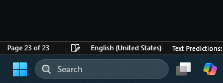

3. Type <code>Disk Management</code>
4. Select <strong>Create and format hard disk partitions</strong>

  
View screenshot

  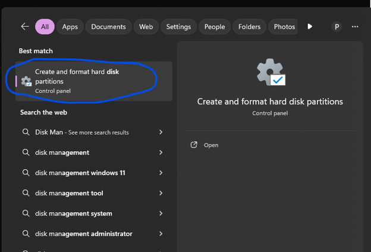

Windows Disk Management displays the connected storage devices, their partitions, and available space.

## 2. Identify the USB Drive and Delete Existing Partitions

⚠️ <strong>WARNING: THIS OPERATION CAN PERMANENTLY ERASE DATA </strong>

Disk Management can be used to delete partitions and format entire storage devices, including your computer's internal system drive. 

Before proceeding, carefully identify your USB storage device by its capacity and existing drive letter. Do not rely on the disk number shown in the original screenshots, as it will vary between computers.

1. Locate your USB drive in the lower section of Disk Management.
2. Verify that you have selected the correct device.

  
View screenshot

  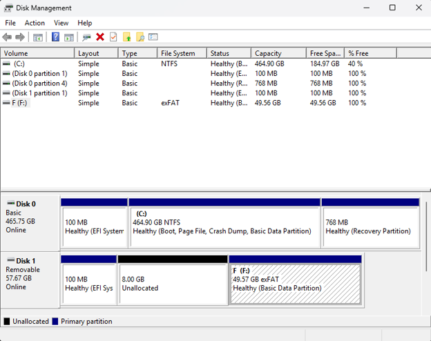

3. If the device contains existing volumes, right-click each applicable volume and select <strong>Delete Volume</strong>.
4. Confirm the deletion if prompted.

Once the existing volumes have been deleted, the available space should appear as unallocated.

  
View screenshot

  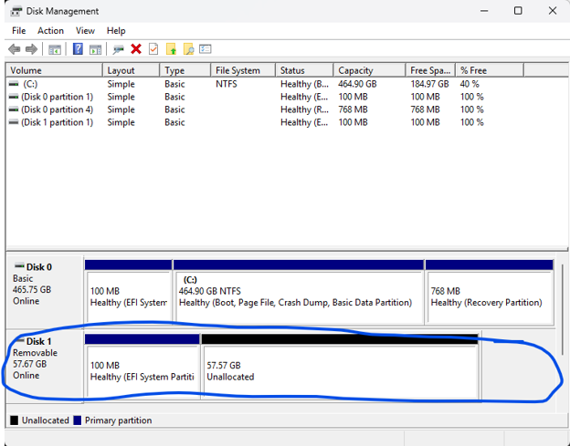

<strong>Note: </strong>Windows may display a small reserved area on the device. The available partition space may therefore be slightly smaller than the advertised capacity of the USB drive. In my case, there is a 100MB Partition reserved for the USB drive's internal mechanisms for formatting which cannot be used to store files.

## 3. Create the First Partition

The first partition will be 8 GB and reserved for the ESXi boot and host files.

1. Right-click the unallocated space on the USB device.
2. Select <strong>New Simple Volume</strong>

  
View screenshot

  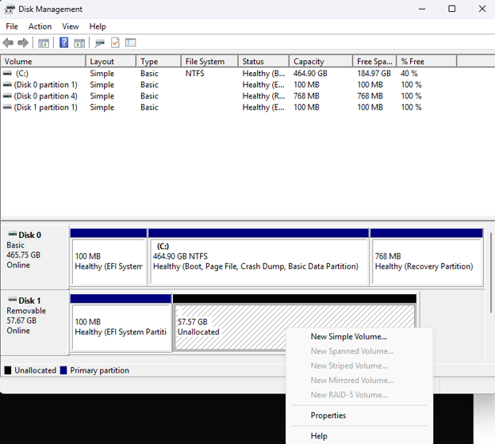

3. When prompted for the volume size, enter 8192 MB.

  
View screenshot

  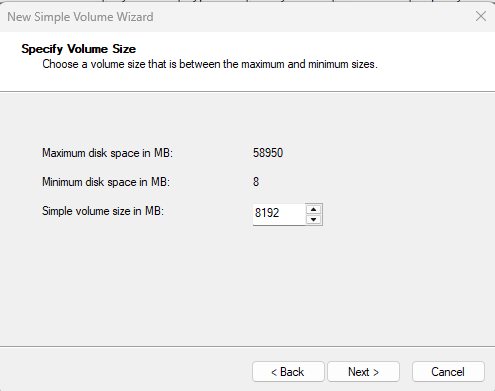

4. Click <strong>Next</strong>.

## 4. Assign a Drive Letter

Windows will ask you to assign a drive letter to the new partition.

1. Select an available drive letter.
2. Click <strong>Next</strong>.

  
View screenshot

  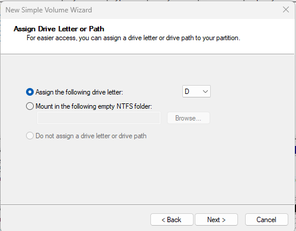

You can use any available drive letter. The letter shown in the original setup is not universal and may differ on your computer. 

## 5. Format the First Partition as FAT32

The first partition will use the FAT32 filesystem.

1. Select <strong>Format this volume with the following settings.</strong>
2. Choose <strong>FAT32</strong> as the filesystem.
3. Enter a descriptive volume label, such as ESXI_BOOT.
4. Leave the remaining settings at their defaults unless you have a specific reason to change them.
5. Click <strong>Next</strong>, then <strong>Finish</strong>.

  
View screenshot

  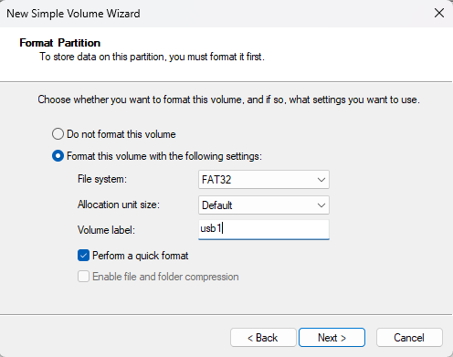

Wait for Windows to complete the formatting process. Once finished, the partition should look similar to this:

  
View screenshot

  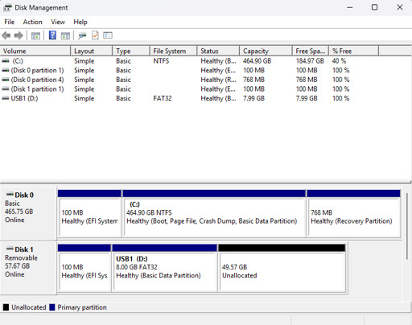

## 6. Create the Second Partition

The remaining unallocated space will be used for the second partition. 

1. Right-click the remaining unallocated space on the same USB device.
2. Select <strong>New Simple Volume</strong>.
3. Use the maximum available volume size so that the second partition occupies the remaining capacity.
4. Click <strong>Next</strong>.
5. Assign an available drive letter.
6. Click <strong>Next</strong>.

## 7. Format the Second Partition as exFAT

The second partition will use exFAT. 

This filesystem was selected in the original project because it accommodates larger storage devices and larger files more conveniently than FAT32.

1. Select <strong>Format this volume with the following settings</strong>.
2. Choose <strong>exFAT</strong> as teh filesystem.
3. Enter a descriptive volume label, such as VM_STORAGE.
4. Leave the remaining settings at their defaults unless otherwise required.
5. Click <strong>Next</strong>, then <strong>Finish</strong>

  
View screenshot

  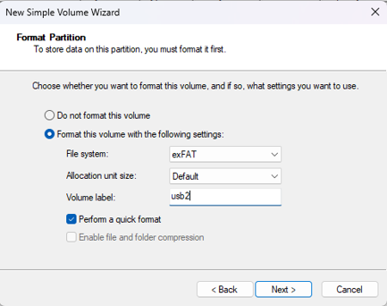

Wait for Windows to complete formatting. 

## 8. Verify the Partition Layout

Once both partitions have been created, return to the main Disk Management window. 

Verify that the USB device contains:

- An 8 GB FAT32 partition labelled ESXI_BOOT (or your own label).
- A second exFAT partition occupying the remaining available space, labelled VM_STORAGE (or your own label).

The final layout should resemble the following:

  
View screenshot

  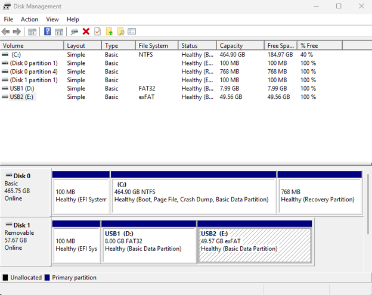

Your USB storage device is now prepared according to the partition layout used in this project.

### Scope and Limitations

This procedure documents the partition preparation in the original project using Windows Disk Management. 

The two partitions are intended for different purposes:

- The FAT32 partition reserves 8 GB for ESXi boot and host files.
- The exFAT partition reserves the remaining capacity for virtual machine storage.

This guide does not demonstrate ESXi installation, datastore creation, or VM deployment. Those operations are separate stages of the virtualization setup. 

<strong>Important</strong>: The filesystem choices documented here describe the Windows preparation procedure. They should not be interpreted as confirmation that ESXi can directly use the exFAT partition as a VM datastore. ESXi datastore creation and supported storage formats are addressed in the subsequent configuration guides. 
