# Guide 5 - OpenWRT DNS Configuration

## Overview

This guide explains how to configure local DNS records and static DHCP leases using OpenWRT.

In this project, OpenWRT acts as the DHCP and DNS server for the isolated Raspberry Pi virtualization network. Configuring local DNS records allows each ESXi host to be accessed using a memorable hostname instead of requiring its IP address to be entered manually. 

For example, instead of accessing an ESXi host using an address such as: 

https://192.168.1.105

You can access it using a hostname:

https://raspberrypi4_1.lan

The guide also explains how to configure static DHCP leases to ensure that each host consistently receives the same IP address. 

## Prerequisites

Before beginning, ensure that:

- OpenWRT is installed and running on the Raspberry Pi router.
- DHCP and DNS services are operational.
- The ESXi hosts are connected to the same network as the OpenWRT router.
- Each ESXi host has successfully booted.
- You can access the OpenWRT LuCI web interface.
- You know the IP address currently assigned to each ESXi host.

The OpenWRT management interface is accessible at: 

http://192.168.1.1

## 1. Log in to the OpenWRT Web Interface

1. Connect your computer to the network switch. (disable wifi to avoid ip address conflicts)
2. Ensure the OpenWRT router and ESXi hosts are connected to the same switch.
3. Open a web browser.
4. Navigate to http://192.168.1.1
5. Log in using the password configured during the OpenWRT installation.

Once logged in, you should see the LuCI administration interface.

<strong>Note</strong>: If you have forgotten your OpenWRT password, you will have to reinstall OpenWRT to your Raspberry Pi using Guide 2 instructions.

## 2. Identify the ESXi Host IP Addresses

Before creating DNS records, identify the IP address assigned to each ESXi host. 

When an ESXi host boots, its management console displays the IP address assigned through DHCP. 

Record the IP address for each Raspberry Pi. You will need these addresses when creating the DNS records. 

## 3. Navigate to DNS Records

Once logged in to OpenWRT: 

1. Open the <strong>Network</strong> menu.

  
View screenshot

  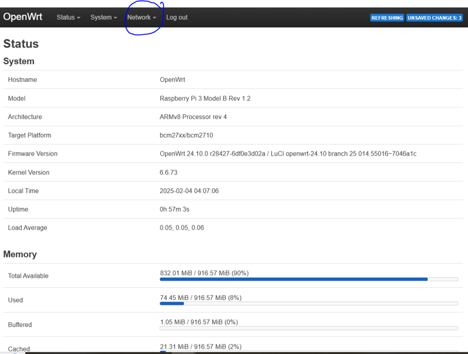

2. Select <strong>DHCP and DNS</strong>.

  
View screenshot

  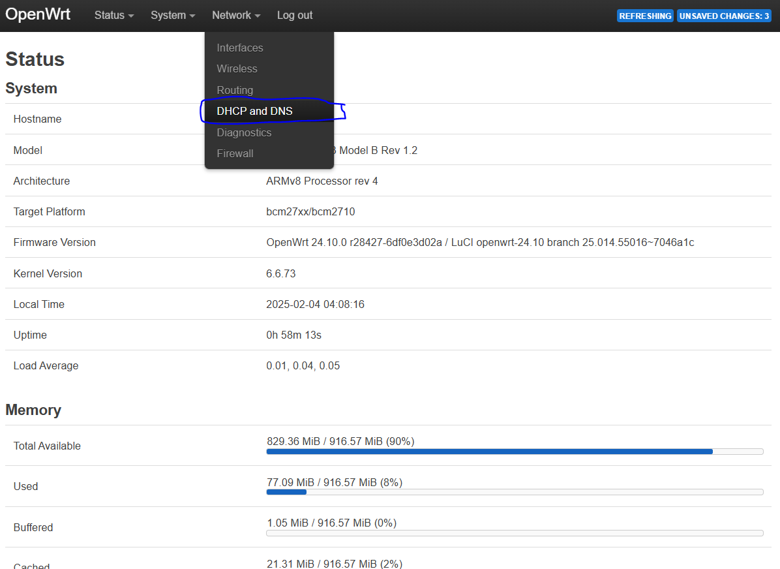

3. Locate the <strong>DNS Records</strong>.

  
View screenshot

  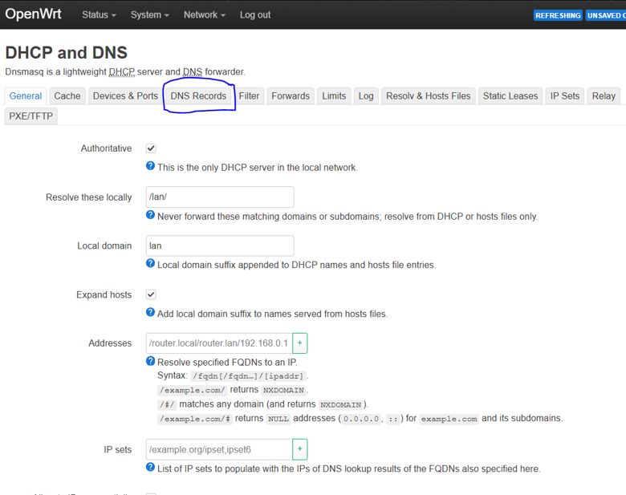

4. Select <strong>Add</strong> to create a new DNS record.

  
View screenshot

  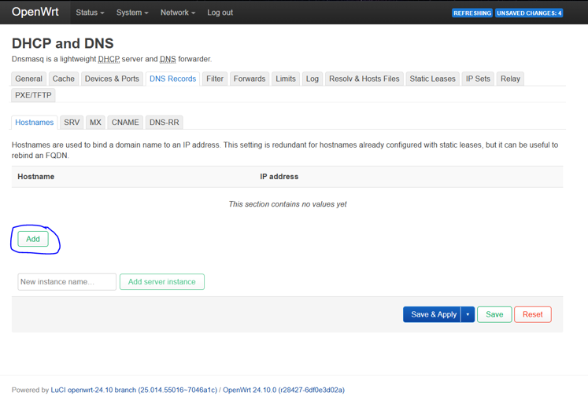

## 4. Create a DNS Record for an ESXi Host

A DNS Record associates a hostname with an IP address. This allows devices on the local network to resolve the hostname without having to remember the IP address.

For each ESXi host:

1. Select the IP address assigned to the device from the available IP address dropdown.

  
View screenshot

  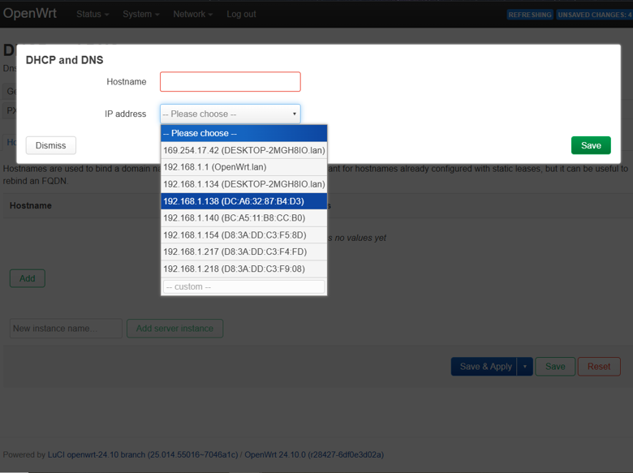

2. Enter a hostname for the device.

  
View screenshot

  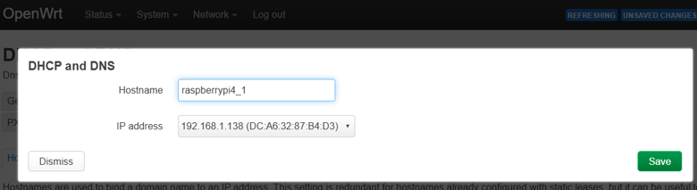 

3. Save the record.

I will name them:
- raspberrypi4_1
- raspberrypi4_2
- raspberrypi4_3
- raspberrypi4_4

## 5. Apply the DNS Configuration

Repeat for all ESXi hosts. After adding the DNS records:
1. Review the hostnames and their corresponding IP addresses.
2. Save the configuration.
3. Select <strong>Apply Changes</strong> to activate the new DNS records.

  
View screenshot

  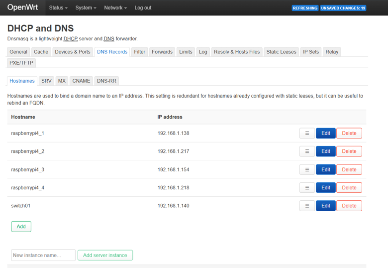

OpenWRT should now be able to resolve each hostname to its associated IP address.

## 6. Configure Static DHCP Leases

Creating DNS records alone does not guarantee that an ESXi host will always receive the same IP. 

DHCP addresses can expire, and a device may receive a different address when it reconnects to the network. If this happens, the DNS record could point to an outdated IP address. 

To prevent this, configure a static DHCP lease for each ESXi host.

### 6.1 Navigate to the Connected Devices

1. Open the <strong>Status</strong> menu.
2. Select <strong>Overview</strong>.
3. Locate the connected devices or DHCP lease list.
4. Find the ESXi host you want to configure.

### 6.2 Set a Static DHCP Lease

For each ESXi host:

1. Identify the correct device using its current IP address and network information.
2. Select <strong>Set Static</strong> beside the corresponding device.
3. Repeat this process for the remaining ESXi hosts.

A static DHCP lease associates a device's MAC address with a reserved IP address. This ensures that the device receives the same IP address when requesting an address from the DHCP server.

<strong>Important</strong>: A static DHCP lease is configured on the DHCP server. It does not manually configure a static IP address on the ESXi host itself.

## 7. Verify DNS Resolution

Once the DNS Records and static DHCP leases have been configured, verify that the hostnames resolve correctly. Open a web browser and enter the hostname of an ESXi host, including the .lan domain suffix.

For example:

<code>https://raspberrypi4_1.lan</code>

You should be directed to the ESXi management interface associated with that hostname. 

  
View screenshot

  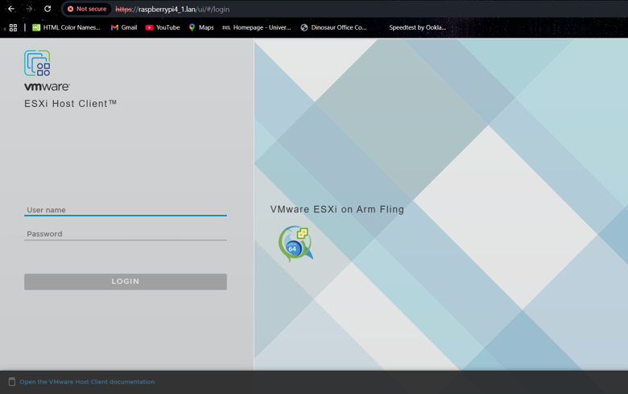

Repeat this process for the remaining ESXi hosts.

## 8. Handle the ESXi Certificate Warning

When accessing ESXi host for the first time, your browser may display a security warning. 

This occurs because the ESXi management interface uses a certificate that your browser does not recognize as trusted.

1. Select <strong>Advanced</strong> on the browser warning page.

  
View screenshot

  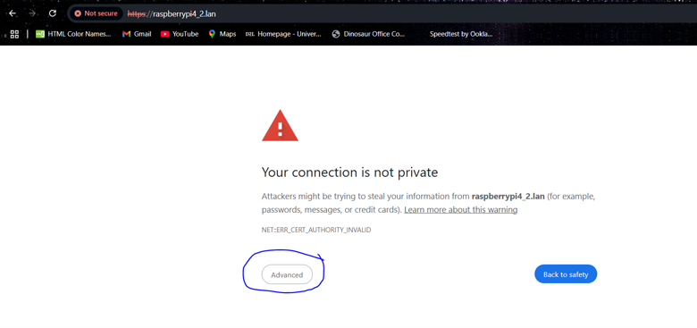

2. Select <strong>Proceed</strong> to continue to the ESXi management interface.

  
View screenshot

  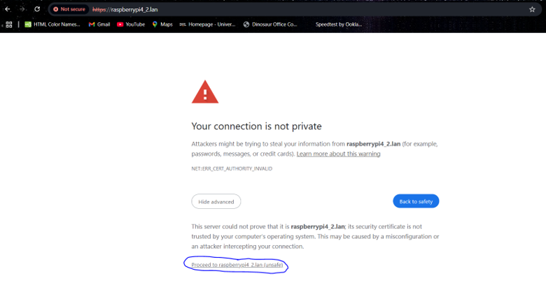

Only proceed after verifying that the hostname and network address correspond to the intended ESXi host. 

## 9. Log in to the ESXi Management Interface

After proceeding past the browser warning:

1. The ESXi login page should appear:

  
View screenshot

  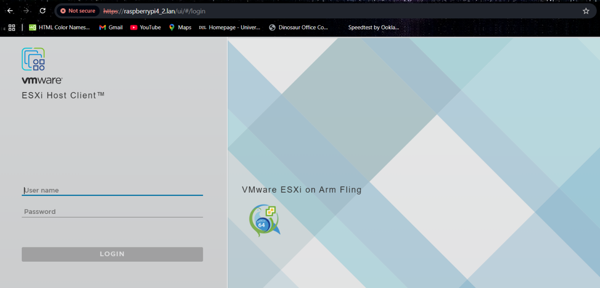

2. Enter <code>root</code> as the username.
3. Enter the root password configured during ESXi installation.
4. Log in to the host.

You should now be able to manage the ESXi host using its local DNS hostname.

Repeat the verification process for all four hosts.

<strong>Note</strong>: You can always connect a monitor and keyboard <strong>before boot</strong> to double check that your ESXi host is running and obtaining an IP address. Your monitor will resemble the following: 

  
View screenshot

  

## 10. Verification and Results

The DNS configuration is successful when:
- Each ESXi host has a corresponding DNS record in OpenWRT.
- Each host has a static DHCP lease.
- Each hostname resolves to the correct IP address.
- Each ESXi management interface is accessible through its <code>.lan</code> hostname.
- The ESXi login page can be reached without manually entering the host's IP address.

The final configuration allows the four ESXi hosts to be accessed using consistent local hostnames:

- <code>https://raspberrypi4_1.lan</code>
- <code>https://raspberrypi4_2.lan</code>
- <code>https://raspberrypi4_3.lan</code>
- <code>https://raspberrypi4_4.lan</code>

  
View screenshot

  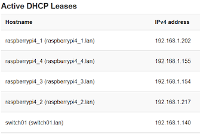

## 11. Scope and Limitations

This guide documents DNS and DHCP configuration through OpenWRT for the Raspberry Pi virtualization lab. 

The configuration provides hostname resolution within the local network. These <code>.lan</code> hostnames are intended for use within the lab and are not publicly accessible internet domain names. 

The guide does not cover: 
- Configuring external DNS services.
- Public domain registration.
- Configuring VLANs or additional network segmentation.
- Registering ESXi hosts in vCenter.
- Creating or configuring ESXi datastores.

Those tasks are addressed separately in subsequent guides. 

## 12. Related Guides

- Guide 1 - Raspberry Pi Boot Configuration
- Guide 2 - OpenWRT Installation on Raspberry Pi
- Guide 3 - USB Storage Preparation for ESXi
- Guide 4 - ESXi Installation on Raspberry Pi 4
- Guide 6 - Add a Datastore to VMware ESXi
