# Guide 6 - Add a Datastore to VMware ESXi

## 1. Overview

This guide describes how to configure a USB storage device as a local datastore on a VMware ESXi host running on a Raspberry Pi.

A datastore provides storage for virtual machine files, virtual disks, and other VM-related data. In this setup, an additional USB storage device is configured as a VMFS 6 datastore.

<strong>Important</strong>: This procedure formats the selected USB device. Any existing data on it will be erased.

This guide covers local USB storage only. The separate OpenMediaVault NAS/NFS storage configuration is outside this guide's scope, but will be covered in a subsequent guide.

## 2. Prerequisites 

Before starting, ensure that you have: 
- A running VMware ESXi host.
- Access to the ESXi Host Client through a web browser.
- SSH access to the ESXi host.
- An additional USB storage device connected to the Raspberry Pi (one for each Raspberry Pi).
- A USB device with no data that needs to be preserved.

The USB device should be prepared before use. If it contains existing partitions or data, back up anything important and reformat it using a supported preparation filesystem such as FAT32 or exFAT. 

<strong>Storage layout used in this project:</strong>

- 32 GB SanDisk USB drive: ESXi installation.
- Original 128 GB USB drive: repurposed as a local VMFS datastore.

The datastore device is separate from the USB device used to boot ESXi.

## 3. Enable SSH on the ESXi Host

SSH is required to configure USB arbitration before ESXi can use the USB storage device as a datastore. 

1. Open the ESXi Host Client in a browser.
2. Navigate to <strong>Host</strong> -> <strong>Actions</strong> -> <strong>Services</strong>.

  
View screenshot

  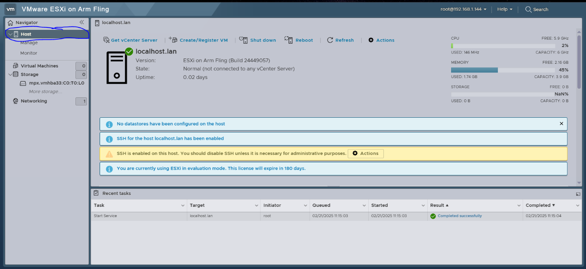

  
View screenshot

  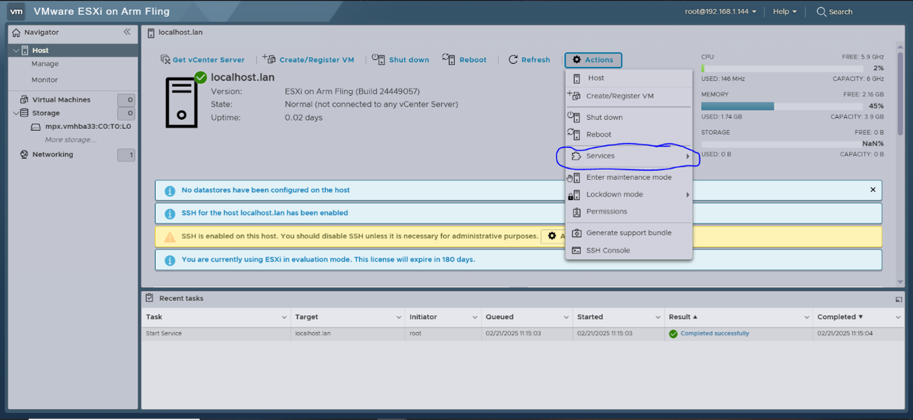

3. Select <strong>Enable Secure Shell (SSH)</strong>.

  
View screenshot

  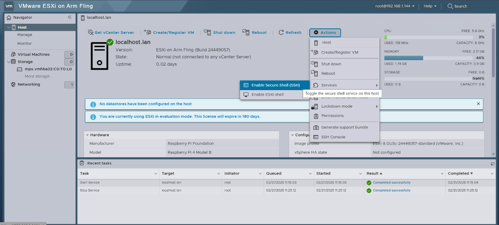

4. Connect to the ESXi host using an SSH client. Under <strong>Actions</strong> go to <strong>SSH Console</strong>.

  
View screenshot

  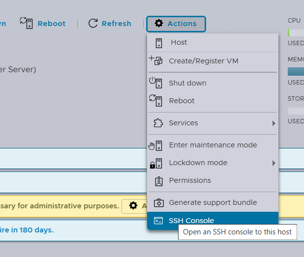

## 4. Disable USB Arbitration

ESXi uses a USB arbitration service to manage USB devices. This service must be stopped and disabled so that the USB storage device can be managed directly by ESXi as storage.

Run the following commands in the SSH session:

<code>/etc/init.d/usbarbitrator stop</code>

<code>chkconfig usbarbitrator off</code>

These commands stop the USB arbitration service for the current session and prevent it from starting automatically on subsequent boots. 

  
View screenshot

  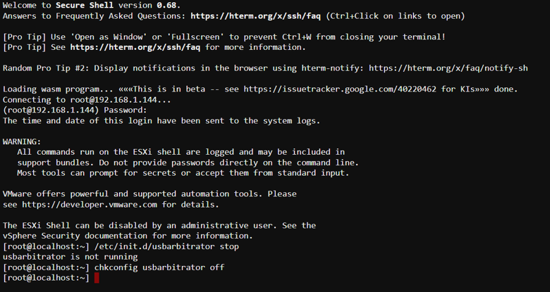

## 5. Connect and Identify the USB Storage Device

1. Connect the additional USB storage device to the Raspberry Pi. (Use blue-coloured port for faster speed)
2. Open the ESXi Host Client.
3. Navigate to <strong>Storage -> Devices</strong>.
4. Locate the newly connected USB storage device.

  
View screenshot

  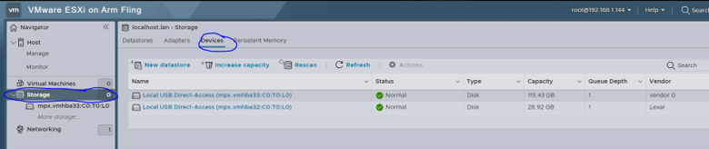

In the original setup, the device appeared under a local USB device entry. It was identified as approximately 115 GB, with the description <strong>vendor 0</strong>.

Confirm that you have selected the correct device before proceeding. 

<strong>If the USB drive is not empty, please refer to Guide 3 document for steps on how to reformat a USB drive for exFAT partition scheme.</strong>

## 6. Create the Datastore

Once the empty USB device has been identified:

1. On the side panel under <strong>Storage</strong>, select your USB device.
2. Select <strong>New Datastore</strong>.

  
View screenshot

  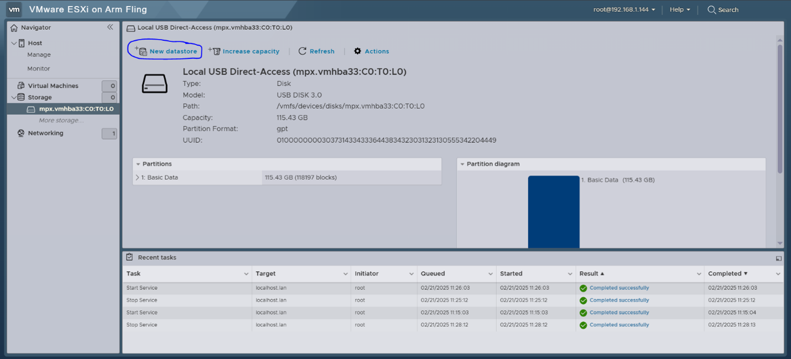

3. Enter a datastore name of your choice and then click <strong>Next</strong>.

  
View screenshot

  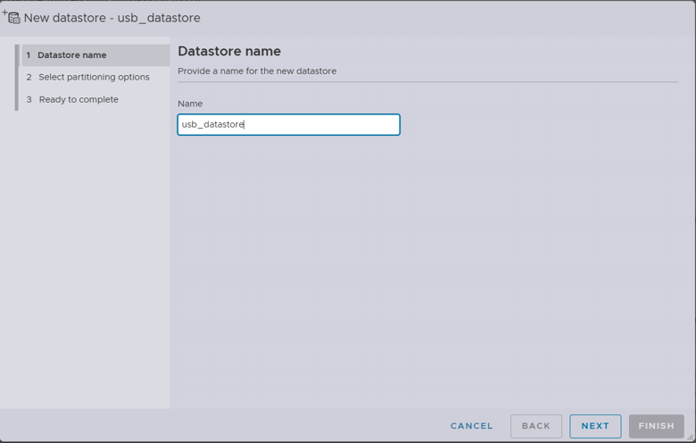

4. The dropdown that states <strong>Custom</strong>, click it and select <strong>Use full disk</strong>.

  
View screenshot

  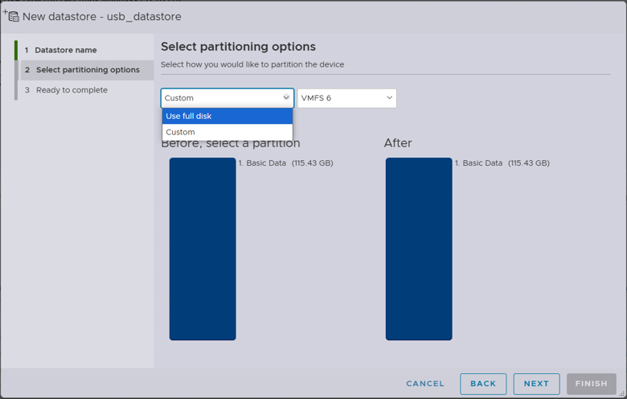

5. Choose VMFS 6 as the datastore filesystem.
6. Review the configuration and select <strong>Next</strong>.
7. Confirm the operation by selecting <strong>Finish</strong>.

  
View screenshot

  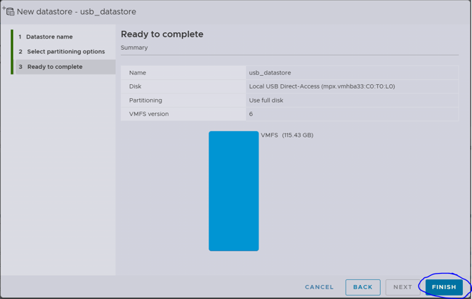

<strong>WARNING</strong>: Creating the datastore reformats the selected device. Double-check the device selection before confirming.

## 7. Verify the Datastore

After the operation completes:

1. Navigate to <strong>Storage -> Datastores</strong>.
2. Confirm that the newly created datastore appears in the list.

  
View screenshot

  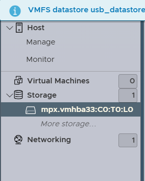

3. Check that its capacity is consistent with the selected USB device.

  
View screenshot

  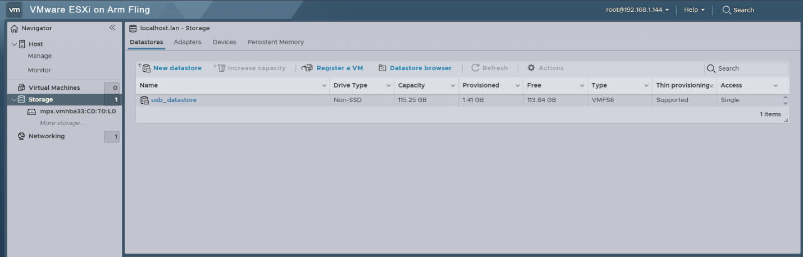

The datastore should now be available to the ESXi host for storing virtual machine files.

## 8. Project Notes and Limitations

- The USB datastore is local to the ESXi host to which the device is connected. It is not automatically shared with other ESXi hosts.
- The project also included a separate OpenMediaVault NAS with a 1 TB SSD, configured to provide NFS storage. That configuration is distinct from this local USB datastore.
- The project did not complete vSAN or clustered shared-storage configuration.
- USB storage compatibility and preformance can vary depending on the device, adapter and ESXi version. 

## 9. Related Guides

- Guide 3 - USB Storage Preparation
- Guide 4 - ESXi Installation on Raspberry Pi
- Guide 5 - OpenWRT DNS Configuration
