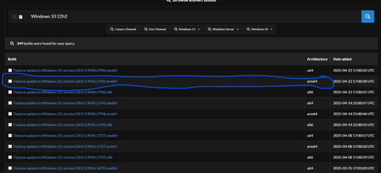
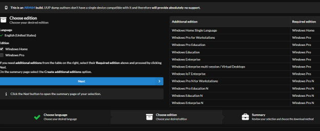
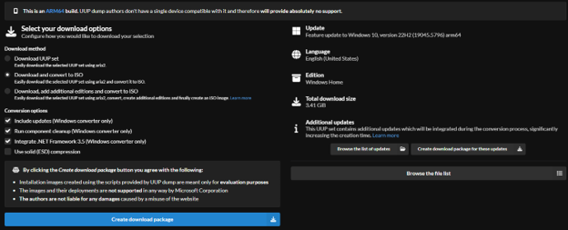
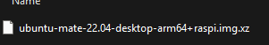
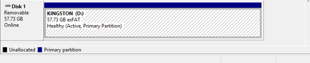
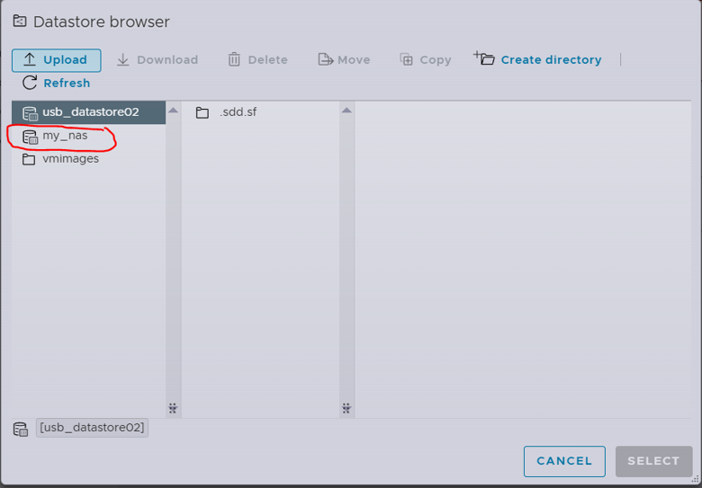

# Guide 8 - Downloading and Uploading ISO Images to VMware ESXi

## 1. Overview

This guide describes how to download operating-system images, prepare them for use with VMware ESXi, and upload them to an ESXi datastore.

VMware ESXi uses ISO images to install guest operating systems inside virtual machines. If an operating system download is provided in another format, it may need to be extracted or converted before it can be uploaded. 

For this project, clean operating-system installation images were stored on the OpenMediaVault NAS, using the my_nas datastore. This allowed the ESXi hosts to access the installation media from shared storage.

The guide covers:

- Downloading Windows ARM64 images.
- Obtaining older Windows versions through UUP Dump.
- Extracting downloaded archives.
- Preparing USB storage for large ISO files when necessary.
- Uploading ISO images to an ESXi datastore.

## 2. Download an Operating-System Image

The download process depends on the operating system you intend to install. 

ESXi uses ISO images for OS installation. If the downloaded file is not already an ISO, it must be extracted or converted into an ISO before uploading.

### 2.1 Windows 11 ARM64

For newer Windows operating systems, such as Windows 11, an ARM64 ISO can be downloaded directly from Microsoft's website: 

<a href="https://www.microsoft.com/en-us/software-download/windows11arm64">Download Windows 11 ARM64</a>

Make sure to select the ARM64 version, as the Raspberry Pi ESXi environment uses ARM architecture (ARM64 refers to the processor found on the Raspberry Pi Model 4). 

### 2.2 Older Windows Versions Using UUP Dump

For older Windows versions, such as Windows 10 or Windows XP, UUP Dump can be used to generate an installation ISO.

Website: 

<a href="https://uupdump.net/known.php?q=Windows+10+ARM64&p=7">UUP Dump - Windows 10 ARM64</a>

In this project, the Windows 10 ARM64 build 19045.5679 was downloaded, and instructions to follow will be for Windows 10. 

1. Visit UUP Dump using link above.
2. Search for <strong>Windows 10 Version 22H2</strong>.
3. Select the ARM64 architecture.
4. Click <strong>Next</strong> to continue.

  
View screenshot

  

### 2.3 Select the Windows Edition

On the edition selection screen, deselect Windows Pro. 

For this project, only Windows Home was required. Windows Pro includes additional features that were unnecessary for the intended VM and would consume additional resources.

  
View screenshot

  

### 2.4 Configure Download Options

On the download options screen:

- Select <strong>Create Download Package</strong>.
- Configure the optional .NET Framework inclusion if required by your intended use.
- Consider enabling <strong>Component Cleanup</strong>, which removes older, unnecessary Windows Setup files.

Component Cleanup is optional but can help produce a cleaner installation image.

Selecting <strong>Create Download Package</strong> generates a ZIP archive containing the files needed to create the Windows ISO. 

 

   
View summary

   
 

## 3. Prepare Images That Are Not Already ISOs

If your downloaded image is not in ISO format, it must be extracted or converted before it can be uploaded to ESXi.

  
View screenshot

  

### 3.1 Extract the Downloaded Archive

If you have 7-Zip installed:

1. Locate the downloaded archive.
2. Right-click the file.
3. Open it using 7-Zip.
4. Extract the contents to a folder on your computer.
5. Locate the resulting ISO image.

For UUP Dump packages, follow the package's included instructions to generate the ISO before proceeding.

### 3.2 Prepare USB Storage for Large ISO Files

If you need to copy a large ISO image to a USB drive, the drive may need to be reformatted.

In the original setup, the USB drive was reformatted to use exFAT because the ISO file exceeded the maximum file size supported by FAT32.

To format the drive (Please refer to Guide 3 if you need more details on how to do this):

1. Connect the USB drive to your computer.
2. Open <strong>Disk Management</strong> in Windows.
3. Locate the appropriate USB drive.
4. Right-click the relevant partition and select <strong>Format</strong>.
5. Select <strong>exFAT</strong> as the filesystem.
6. Complete the formatting process.

<strong>Warning</strong>: Formatting erases the existing data on the selected partition. Back up any files you need before proceeding, and verify that you have selected the correct USB drive.

<strong>Note</strong>: This formatting step is only necessary if using the USB transfer method. It is not required when uploading the ISO directly from your computer through the ESXi Host Client.

  
View screenshot

  

## 4. Upload the ISO Image to the ESXi Datastore

Once the ISO image is ready, it can be uploaded to an ESXi datastore.

For this project, the clean operating-system images were stored on the OpenMediaVault NAS rather than the local USB datastore; though the USB datastores were tested for OS launch capabilities (i.e. booting into an OS using a USB as the OS's local hard drive)

### 4.1 Open the NAS Datastore

1. Open the ESXi Host Client in your browser.
2. Navigate to <strong>Storage -> Datastores</strong>.
3. Select the <code>my_nas</code> datastore created earlier.

This datastore is backed by OpenMediaVault NAS configured in Guide 7. 

  
View screenshot

  

### 4.2 Upload the ISO Image

1. Open the datastore browser for <code>my_nas</code>.
2. Select <strong>Upload</strong>.
3. Browse to the ISO image on your computer.
4. Select the file and begin the upload.
5. Wait for the upload to finish.

The ISO image will now be stored on the NAS and available for use when creating Virtual Machines.

## 5. Verify the Uploaded Image

After the upload completes:

1. Open the <code>my_nas</code> datastore browser.
2. Locate the uploaded ISO image.
3. Confirm that the filename and file extension are correct (.iso)
4. Ensure that the upload completed successfully.

The ISO is now ready to be selected during virtual machine creation!

## 6. Project Notes and Considerations

- Windows 10 ARM64 build 19045.5679 was used in the original project.
- Windows 11 ARM64 can be downloaded directly from Microsoft.
- UUP Dump was used to obtain an older Windows ARM64 installation image.
- ISO images were stored on the OpenMediaVault <code>my_nas</code> datastore.
- The USB formatting procedure was included as an alternative method for transferring large files.
- Linux distributions were generally more straightforward to prepare and install, using their respective installation ISOs. (in submitted project, Fedora, uBuntu, Kali Linux, CentOS were easily installed ARM64 versions for each using their official installation ISOs found on their respective websites).

<strong>Important</strong>: The Windows download links and UUP Dump interface may change over time. The build number documented here reflects the original project, not necessarily the latest available release.

## 7. Related Guides

- Guide 3 - USB Storage Preparation
- Guide 4 - ESXi Installation on Raspberry Pi
- Guide 6 - Add a Datastore to VMware ESXi
- Guide 7 - OpenMediaVault NAS Installation and NFS Datastore Configuration
- Guide 9 - Creating a Virtual Machine Using an ISO
