# Raspberry Pi Boot Configuration

This guide documents how to prepare a Raspberry Pi bootloader for a selected boot method using Raspberry Pi Imager. It was developed as part of a larger project to build a virtualized environment for isolated malware-analysis research.

## Objectives

- Identify the available Raspberry Pi boot methods.
- Prepare a microSD card with the appropriate bootloader utility.
- Configure the desired boot method.
- Verify that the bootloader preparation process completes.

## Prerequisites

- A compatible Raspberry Pi.
- A microSD card.
- A microSD card reader or USB adapter.
- A computer with internet access.
- Raspberry Pi Imager
- A monitor and compatible cable for optional local verification

<strong>Warning: Writing an image to a storage device can erase its existing contents. Confirm that the correct microSD card is selected before proceeding and backup any data you need to retain.</strong>

## 1. Understand the Boot Options

The original project documentation considered three boot methods:
- <b>SD card:</b> Boot using a microSD card.
- <b>USD:</b> Boot using a supported USB storage device.
- <b>Network:</b> Boot using a supported network-boot configuration.

The available options depend on the Raspberry Pi model, bootloader configuration, and supported hardware. This procedure prepares the bootloader; it does not configure a complete network-boot environment.

For the original project, USB boot preparation was relevant to the planned virtualization setup.

## 2. Download Raspberry Pi Imager

1. Open the <a href="https://www.raspberrypi.com/software/">official Raspberry Pi software page</a>
2. Download Raspberry Pi Imager for your computer's operating system.
   

     
View screenshot

      
     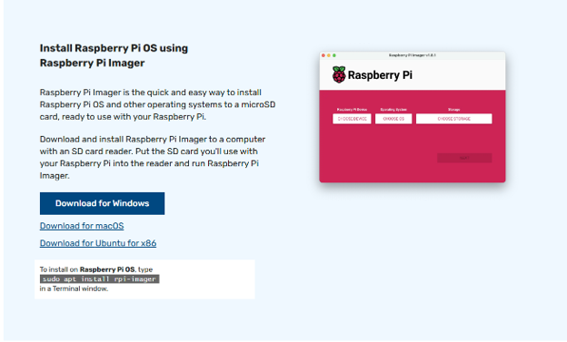
   

3. Install and launch the application.

Use the official download source to reduce the risk of obtaining a modified installer.

## 3. Connect the microSD card

1. Insert the microSD card into your computer, using an adapter if necessary 
   

     
View screenshot

      
     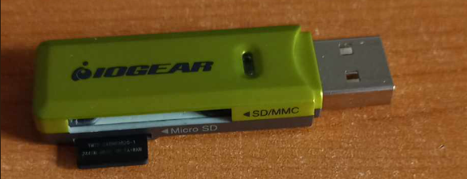
   

2. Confirm that the card is detected.
3. Identify the card's capacity and verify that it is the intended target.

<strong>Do not proceed if you cannot confidently distinguish the microSD card from other connected storage devices!</strong>

## 4. Select the Raspberry Pi model

1. In Raspberry Pi Imager, open <strong>Choose Device</strong>

   
View screenshot

      
   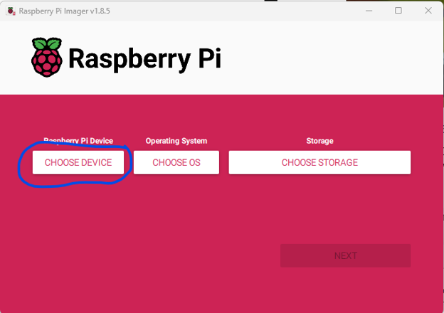

2. Select the model corresponding to the Raspberry Pi you intend to configure

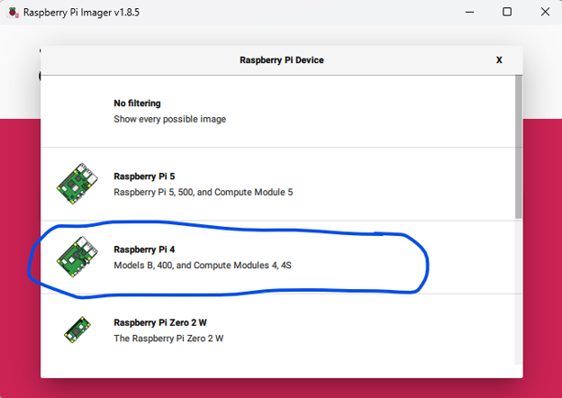 

The original project used a Raspberry Pi 4 for this procedure. Select the model appropriate to your own hardware rather than assuming all models use identical bootloader options.

## 5. Select the bootloader utility

1. Open <strong>Choose OS</strong>
2. Navigate to <strong>Misc utility images</strong>

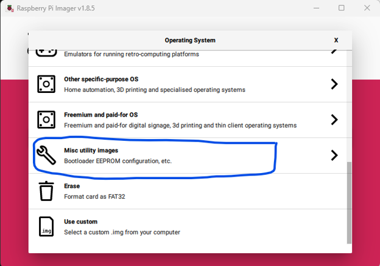
3. Locate the bootloader or boot-method utility appropriate to your intended configuration.
4. Select the relevant option

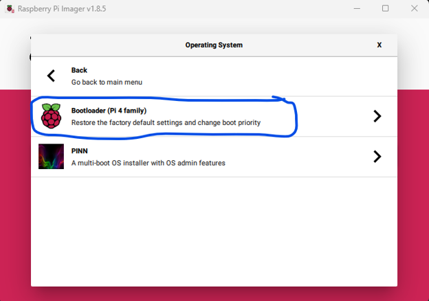

The original documentation used this menu to access the bootloader configuration utilties. Menu names and available options can change between Raspberry Pi Imager releases, so verify the current interface before following this step verbatim.

## 6. Choose the boot method and storage device

1. Select the desired boot method, such as USB or network boot, if supported by the chosen utility and Raspberry Pi model. Note that SD card boot is the default method.

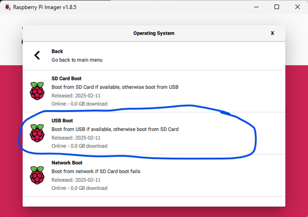

2. Open <strong>Choose Storage</strong>
3. Select the microSD card identified earlier.

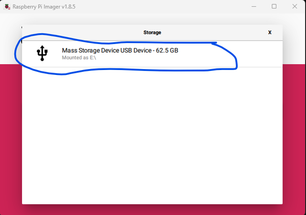 

4. Review the selected device before confirming the write operation.

   
View screenshot

   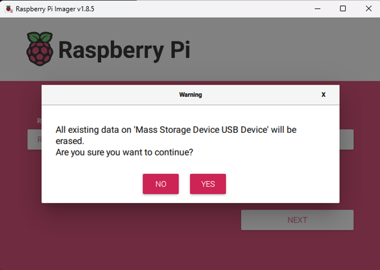

<strong>Important:</strong> The selected microSD card is the destination for the utility image. Selecting the wrong storage device can cause unintended data loss!

5. Continue through the confirmation prompts to write the image.

## 7. Boot the Raspberry Pi and verify the result 

1. Safely remove the microSD card after the imaging process completes.
2. Insert it into the Raspberry Pi
3. Connect a monitor using a compatible display cable if local verification is required.

   
View screenshot

   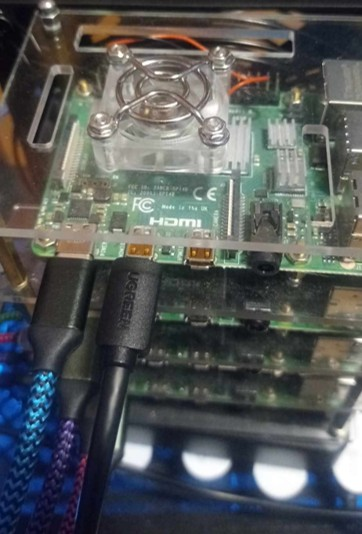

5. Power on the Raspberry Pi and observe the displayed output. It should be a fully green monitor like the picture below if you are using the same model.

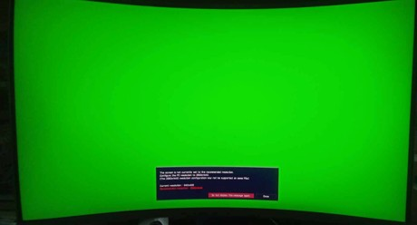

Note: Because display behaviour may vary by model, utility image, and software version, confirm the expected indicator for the utility you selected before treating this as definitive verification. 

### Troubleshooting

If the expected result does not appear:
- Confirm that the correct Raspberry Pi model was selected.
- Check that the image-writing and verification process completed successfully.
- Recheck the selected boot method and microSD card.
- Consult the current Raspberry Pi documentation for model-specific recovery or troubleshooting steps.

### Security and operational considerations
- Use the official Raspberry Pi software source (this should be obvious!)
- Verify the target storage device before any destructive write.
- Keep the bootloader configuration appropriate to the intended hardware and deployment.
- Do not assume that changing the boot method alone provides network isolation or other security controls.
- Record the Raspberry Pi model and relevant software versions when documenting a reproducible setup.

### Scope and limitations

This guide covers bootloader preparation only. It does not configure anything else. The original procedure was developed as part of an academic infrastructure project. Before using this guide on current hardware, verify that the menu options and success indicators match the Raspberry Pi model and the Raspberry Pi Imager version in use.

### See other guide docs for related documentation

