# Guide 10 - Deploying VMware vCenter Server Appliance

## 1. Overview

This guide documents the deployment and configuration of VMware vCenter Server Appliance (VCSA) using VMware Workstation Pro 17.

In this project, vCenter was deployed as a virtual appliance running inside VMware Workstation on a separate laptop. Once configured, it provided the centralized management interface used to administer the four Raspberry Pi 4 devices running VMware ESXi ARM. 

The guide covers:

- Downloading the vCenter Server Appliance installation media.
- Extracting the appliance files.
- Converting the OVA package into OVF format.
- Modifying the OVF configuration.
- Importing the appliance into VMware Workstation.
- Configuring and deploying the appliance.
- Completing the second configuration stage.
- Accessing the vSphere Client.

## 2. Prerequisites

Before deploying vCenter, ensure that you have:

- A laptop with minimum 16 GB of physical RAM.
- Sufficient available storage for the Virtual Appliance.
- A working connection to the lab environment.
- OpenWRT configured with the required DNS records.

## 3. Download and Install VMware Workstation Pro 17

vCenter must be hosted inside a Virtual Machine. We will install VMware Workstation Pro 17, and then deploy vCenter inside this. This requires a laptop of minimum 16 GB of RAM, though 24+ GB would provide better performance.

1. Login to your Broadcom Account (you can create one if this has not already been done).
2. Head to the following link (may have changed since project):
<a href="https://support.broadcom.com/group/ecx/productdownloads?subfamily=VMware%20Workstation%20Pro&freeDownloads=true">VMware Workstation Pro 17 Download Page</a>

  
View screenshot

  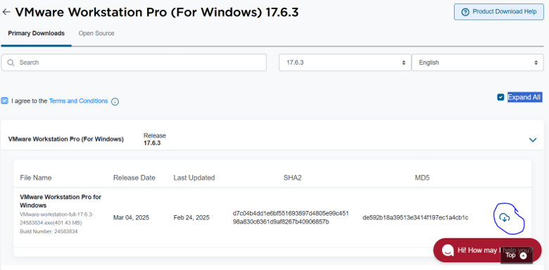

3. Install Workstation Pro 17 

  
View screenshot

  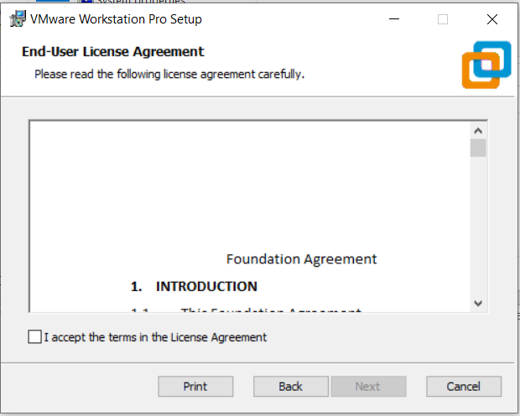

  
View screenshot

  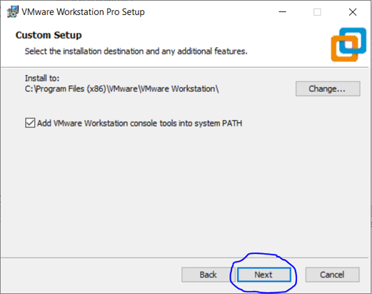

  
View screenshot

  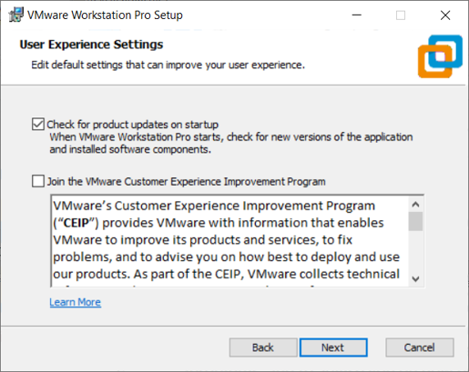

  
View screenshot

  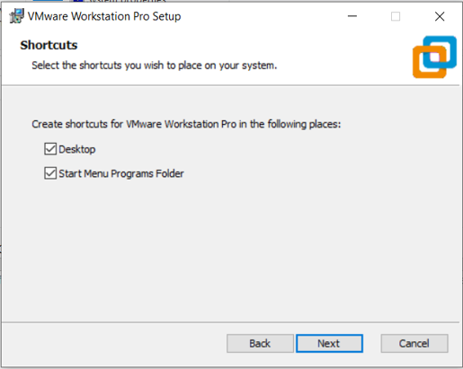

  
View screenshot

  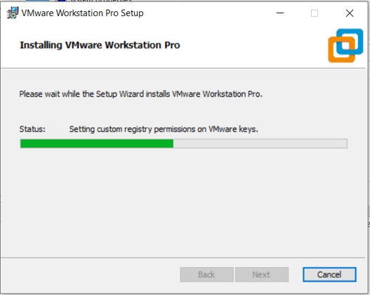

  
View screenshot

  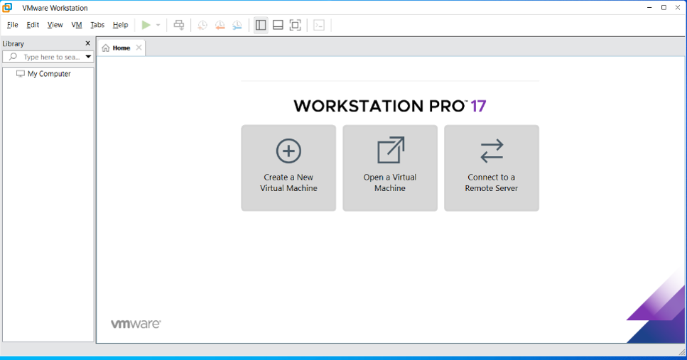

## 4. Buy the vCenter License and Download

The project used the following version:

<table>
  <tr>
    <th>Component</th>
    <th>Version</th>
  </tr>
  <tr>
    <td>Product</td>
    <td>VMware vCenter Server Appliance</td>
  </tr>
  <tr>
    <td>Version</td>
    <td>8.0.0.10000</td>
  </tr>
  <tr>
    <td>Build</td>
    <td>20519528</td>
  </tr>
  <tr>
    <td>Deployment Platform</td>
    <td>VMware Workstation Pro 17</td>
  </tr>
  <tr>
    <td>Deployment Size</td>
    <td>Tiny</td>
  </tr>
</table>

The cost of this license as of the writing of the project was $15.90 and the link (after login to your Broadcom Account) is:

<a href="https://ca.productkeys.com/product/vmware-vcenter-server-8-standard-vsphere-8-enterprise-plus-bundle-cd-key/?utm_source=Google%20Shopping&utm_campaign=BuyKeys-GoogleFeed&utm_medium=cpc&utm_term=329417&gad_source=1&gclid=CjwKCAjwwLO_BhB2EiwAx2e-3_BphhB3X_1S8f_ahRGWZyoFagUpTOp9GfMRICpaVdG91P1ebacgTxoC07EQAvD_BwE">VMware vCenter Server License Purchase and Download</a>

1. Purchase License.
2. Open the PDF in your email's inbox and click the download link:

  
View screenshot

  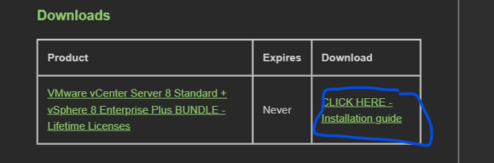

3. Click on the ISO file under vCenter / vSphere

  
View screenshot

  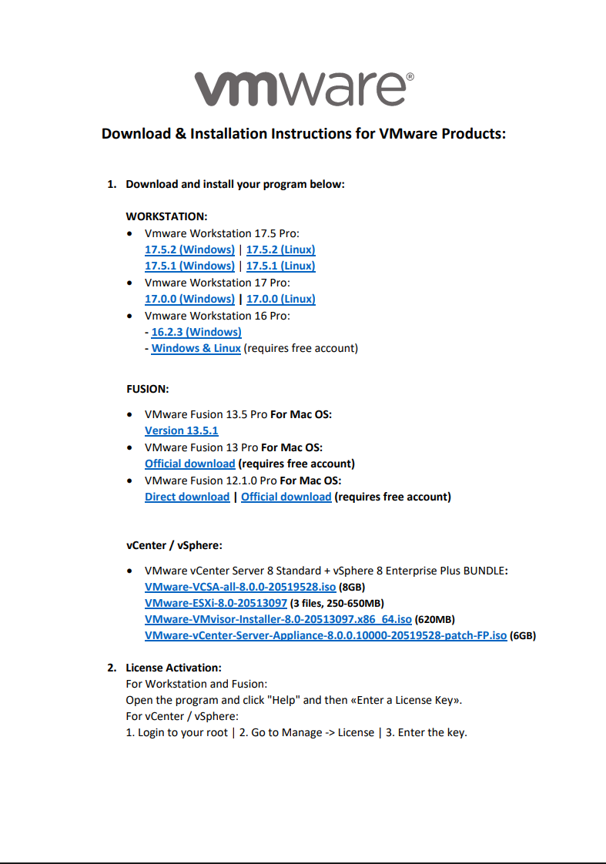

The installation media used in the project was:

<code>VMware-VCSA-all-8.0.0.10000-20519528.iso</code>

<strong>Note</strong>: I have provided the link, however always use authorized installation sources when downloading software, files, etc. and verify the integrity of the installation media before deploying it.

## 5. Extract the vCenter Appliance Files

Once the ISO has been obtained:

1. Navigate to your VMware VCSA ISO file:

  
View screenshot

  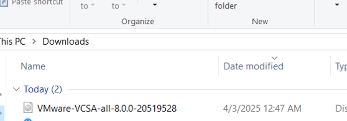

2. Double-click on this file and mount it if prompted.

  
View screenshot

  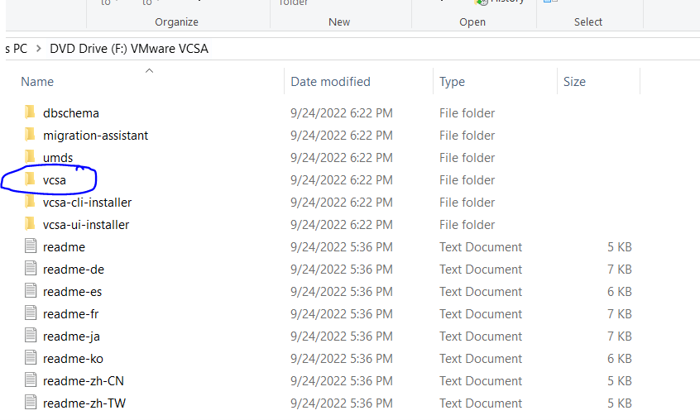

3. Create a Folder on your Desktop and Copy & Paste the VCSA folder highlighted in above image into it.

## 6. Convert OVA to OVF Using OVF Tool

VMware Workstation requires the appliance to be prepared in OVF format for the import procedure used in this project. 

The VMware installation media includes the OVF Tool (<code>ovftool</code>).

### 6.1 Locate OVF Tool

1. Navigate to the extracted VCSA directory.
2. Locate the bundled <code>ovftool</code> executable. This should be inside the vcsa folder pasted into your New Folder created on Desktop.
3. Open Command Line (right-click and <strong>Run As Administrator</strong>).
4. Assuming the vcsa folder is inside the folder you created on your desktop, use the following command (replace the curly braces with your actual path):
<code>setx PATH "%PATH%;C:\{path_up_to_Desktop}\Desktop\{foldername}\vcsa\ovftool\win32 "</code>

### 6.2 Convert the OVA to OVF

1. Restart your command line.
2. Navigate to your \vcsa folder using cd (example commands):

<code>cd Desktop</code>
<code>cd {folder_name}</code>
<code>cd vcsa</code>

3. Use the following command to convert the ova to ovf file:

<code>ovftool .\VMware-vCenter-Server-Appliance-8.0.0.10000-20519528_OVF10.ova .\VMware-vCenter-Server-Appliance-8.0.0.10000-20519528_OVF10.ovf</code>

4. Once converted, delete the original OVA file

  
View screenshot

  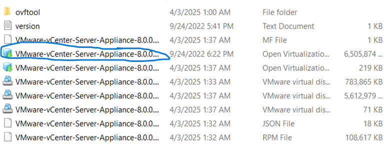

5. Create a New Folder on Desktop and name. I named mine <strong>VCSA8</strong> and Copy and Paste all VMware Files into it.

  
View screenshot

  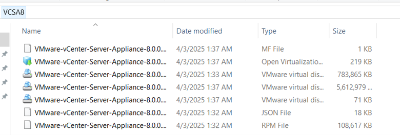

6. Delete the Manifest (MF) file. Resulting files shown below:

  
View screenshot

  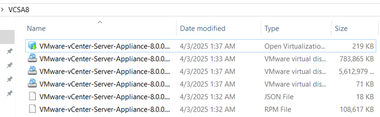

## 7. Modify the OVF Configuration

Before importing the OVF into VMware Workstation, one configuration value must be changed.

1. Locate the main <code>.ovf</code> file generated during conversion.
2. Open the file using a text editor.
3. Search for the following configuration property (using CTRL+F):
<code>guestinfo.cis.upgrade.import.directory</code>

  
View screenshot

  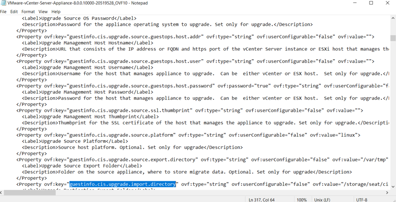

4. Change the <code>ovf:userConfigurable</code> property to <code>true</code>.

  
View screenshot

  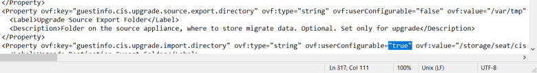

5. Go to File and Save the modified OVF file.

This adjustment allows the appliance to be configurable during import into VMware Workstation.

## 8. Import the OVF into VMware Workstation

With the OVF package prepared:

1. Open VMware Workstation Pro 17.
2. Select <strong>File -> Open</strong>.

  
View screenshot

  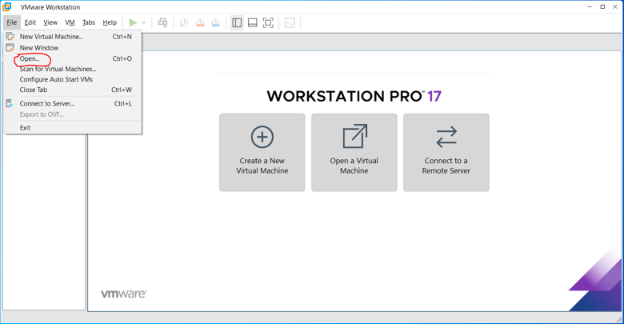

3. Browse to the converted OVF file.

  
View screenshot

  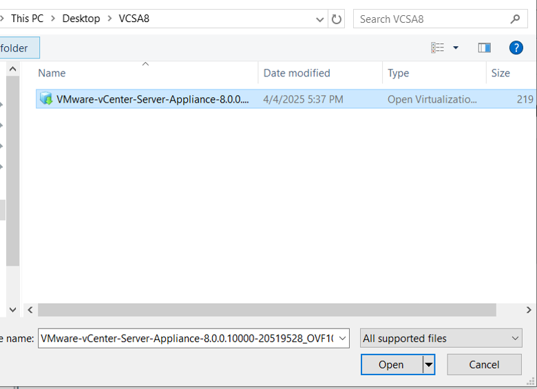

4. Accept the EULA.

  
View screenshot

  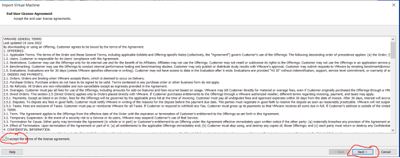

5. Configure VM settings. <strong>For the name, DO NOT USE THE UNDERSCORE CHARACTER, PHASE TWO WILL CRASH</strong>.

  
View screenshot

  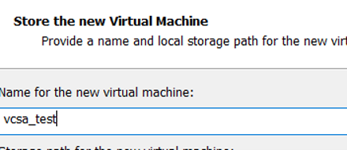

6. Select the <strong>Tiny vCenter</strong> deployment configuration when prompted. (4 hosts and less than 2 TB storage.

  
View screenshot

  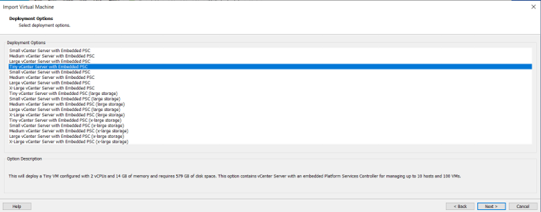

This deployment size was selected for the lab environment.

## 9. Configure the vCenter Server Appliance

During appliance configuration, provide the required network and authentication settings.

### 9.1 Configure the Hostname

Assign a hostname to the appliance.

<strong>Important</strong>: Use an alphanumeric hostname without underscores or special characters.

During the original deployment, using an underscore in the hostname caused Phase 2 of the configuration to crash.

The final local domain used for the vCenter appliance was: 

<code>vsphere.local</code>

  
View screenshot

  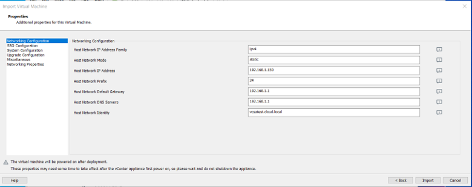

### 9.2 Configure Authentication

Configure the appliance's root password and SSO credentials.

The SSO account used in this project was: 

<code>administrator@vsphere.local</code>

Note that vsphere.local is the domain name. 

Keep the root and SSO credentials secure. They are separate authentication contexts and should not be treated as interchangeable.

  
View screenshot

  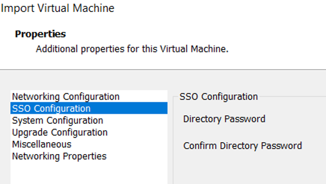

### 9.3 Customer Experience Improvement Program 

CEIP was left unchecked. The environment is an isolated lab and not configured for internet connectivity. 

## 10. Complete Phase 1 of vCenter Server Setup.

The screen should look similar to the following once you've clicked Import, and imported vCenter with the configurations provided. 

  
View screenshot

  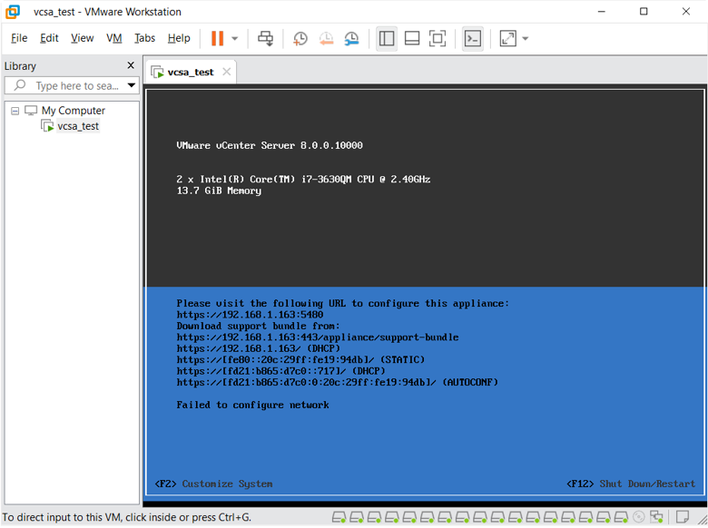

## 11. Complete Phase 2 Configuration

Once the initial appliance deployment has completed, the second configuration stage must be performed.

Open a browser and navigate to the appliance management interface:

<code>https://192.168.1.163:5480</code>

This was the IP address used by the vCenter appliance during initial setup. 

  
View screenshot

  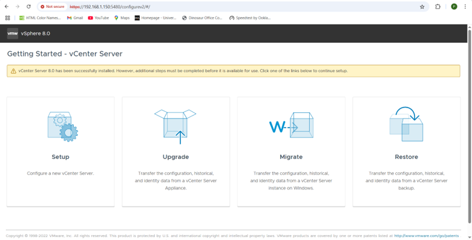

1. Click the Setup button to begin the setup wizard.

  
View screenshot

  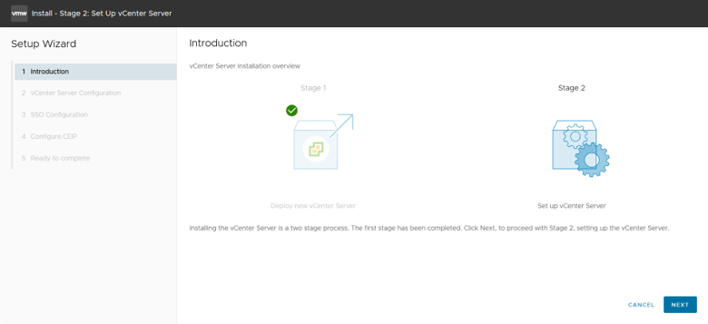

2. Configure the vCenter Server as follows:

  
View screenshot

  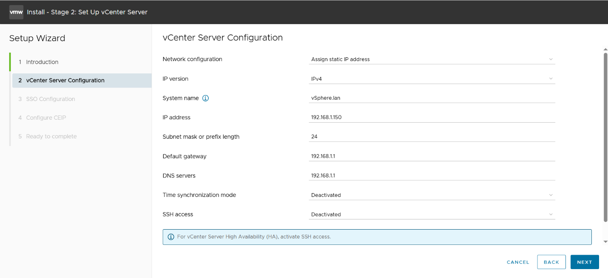

3. Setup SSO, see example below:

  
View screenshot

  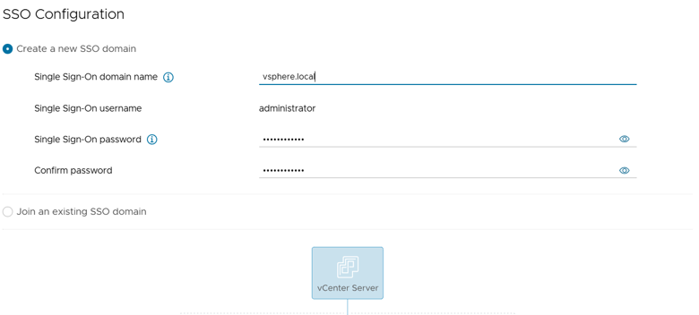

4. Deselect Join Customer Experience Improvement Program

  
View screenshot

  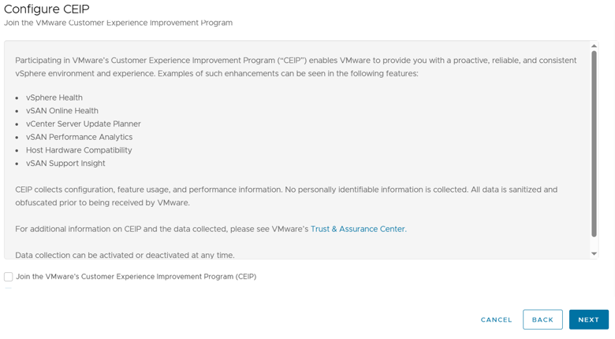

5. Verify Configurations

  
View screenshot

  

6. Click <strong>Finish</strong> and <strong>OK</strong>.

  
View screenshot

  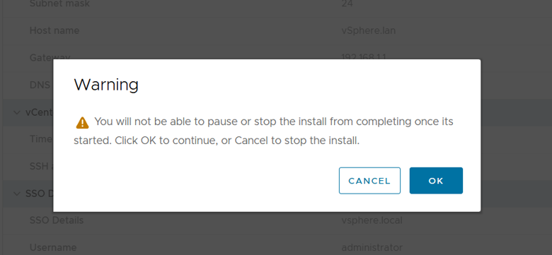

7. Login using <strong>root</strong> and the password is the root password configured previously.

  
View screenshot

  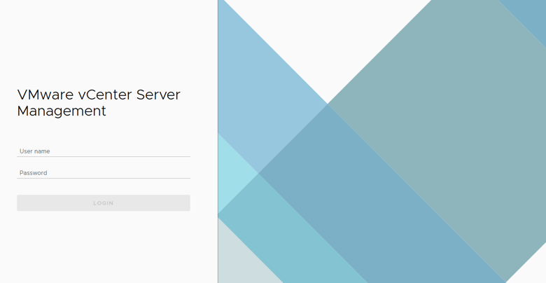

  
View screenshot

  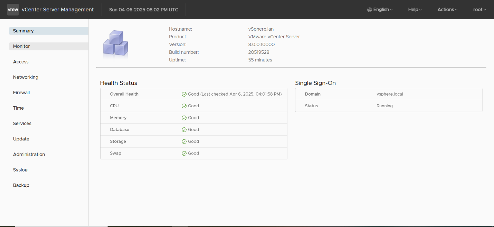

## 12. Project Notes and Limitations

- vCenter Server Appliance 8.0.0.10000 (build 20519528) was deployed using VMware Workstation Pro 17.
- The Tiny deployment size was selected due to the laptop's limited resources.
- The vCenter appliance was configured with the vsphere.local SSO domain.
- The appliance management interface was accessed at https://192.168.1.163:5480.
- The vSphere Client was accessed at https://vsphere.lan.
- The laptop hosted vCenter separately from the Raspberry Pi ESXi infrastructure.

This guide covers vCenter deployment only. Registering ESXi hosts and configuring the vSphere inventory are covered in Guide 11. 

## 13. Related Guides

- Guide 5 - OpenWRT DNS Configuration
- Guide 7 - OpenMediaVault NAS Installation and NFS Datastore Configuration
- Guide 11 - Adding ESXi Hosts to vCenter Server
