# Guide 11 - Adding ESXi Hosts to vCenter Server

## 1. Overview

This guide describes how to register multiple VMware ESXi hosts with a centralized vCenter Server.

Following the successful deployment of vCenter Server Appliance in Guide 10, the next step is to add the four Raspberry Pi 4 devices running VMware ESXi ARM.

Registering the hosts allows them to be managed centrally through the vSphere Client rather than accessing each ESXi Host Client individually.

The guide covers:

- Creating a datacenter in vCenter.
- Adding ESXi hosts to the vCenter inventory.
- Providing host credentials.
- Selecting licensing options.
- Configuring Lockdown Mode.
- Verifying that all four hosts have been registered.
- Documenting the subsequent cluster creation attempt.

## 2. Prerequisites

Before starting, ensure that you have:

- A successfully deployed vCenter Server Appliance
- Access to the vSphere Client.
- Four running Raspberry Pi 4 ESXi hosts.
- The ESXi root credentials for each host.
- OpenWRT configured with DNS records for all four hosts.
- Network connectivity between the vCenter appliance and ESXi hosts.

The vCenter Server used in this project was accessible at:

<code>https://vsphere.lan</code>

The SSO account used to access the vSphere Client was: 

<code>administrator@vsphere.local</code>

## 3. Project Architecture

The four ESXi hosts used in this project were: 

<table>
  <tr>
    <th>ESXi Host</th>
    <th>Hostname</th>
    <th>Hardware</th>
  </tr>
  <tr>
    <td>Raspberry Pi 4-1</td>
    <td>raspberrypi4_1.lan</td>
    <td>4 GB RAM</td>
  </tr>
  <tr>
    <td>Raspberry Pi 4-2</td>
    <td>raspberrypi4_2.lan</td>
    <td>8 GB RAM</td>
  </tr>
  <tr>
    <td>Raspberry Pi 4-3</td>
    <td>raspberrypi4_3.lan</td>
    <td>8 GB RAM</td>
  </tr>
  <tr>
    <td>Raspberry Pi 4-4</td>
    <td>raspberrypi4_4.lan</td>
    <td>8 GB RAM</td>
  </tr>
</table>

These hostnames were configured through OpenWRT DNS in Guide 5.

## 4. Create a Datacenter

After logging into the vSphere Client (see images below):

  
View screenshot

  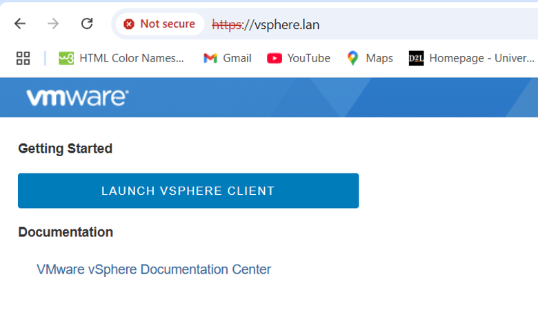

  
View screenshot

  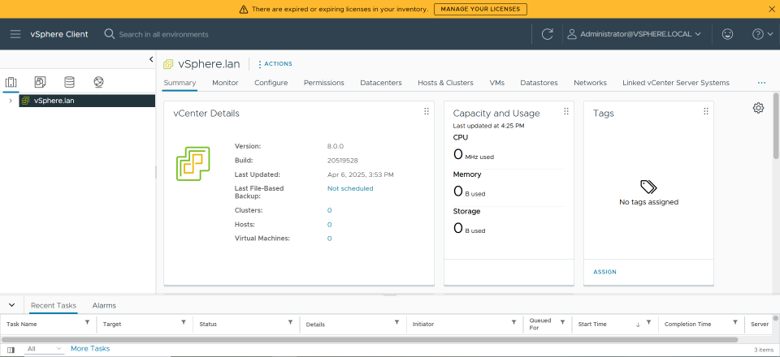

1. Navigate to the inventory panel on the left.

  
View screenshot

  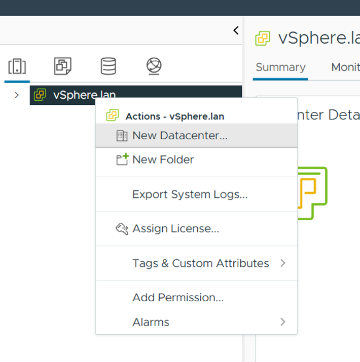

2. Select the vCenter Server inventory and click <strong>New Datacenter</strong>
3. Enter the datacenter name.

  
View screenshot

  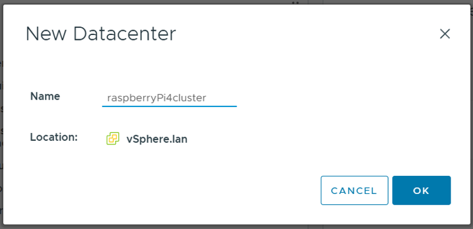

<code>raspberryPi4cluster</code>

The datacenter acts as the logical container for the ESXi hosts.

<strong>Important</strong>: Create a datacenter, not a cluster. The hosts must first be registered in the datacenter before attempting to creating a cluster.

## 5. Add the First ESXi Host

Once the datacenter has been created:

1. Select <code>vSphere.lan</code> in the left-hand inventory panel.
2. Right-click the datacenter.

  
View screenshot

  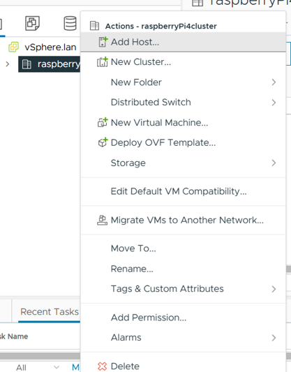

3. Select <strong>Add Hosts</strong>.
4. Enter the hostname or IP address of the first ESXi host.

For example (reference earlier table):

<code>raspberrypi4_1.lan</code>

Continue through the wizard.

## 6. Enter ESXi Host Credentials

When prompted, provide the ESXi host credentials.

Use the following account:

<table>
  <tr>
    <th>Setting</th>
    <th>Value</th>
  </tr>
  <tr>
    <td>Username</td>
    <td>root</td>
  </tr>
  <tr>
    <td>Password</td>
    <td>The root password configured during ESXi installation</td>
  </tr>
</table>

  
View screenshot

  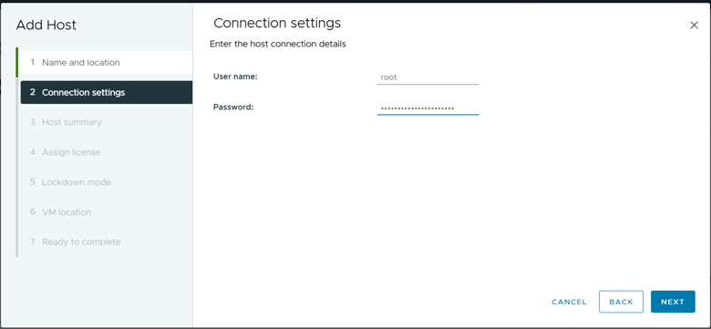

Accept the host certificate or security prompt if presented (Step 3 Host Summary), as appropriate for the lab environment.

Continue to Step 4 of the wizard.

## 7. Configure Host Licensing

When prompted to select a license, choose:

<strong>Evaluation License</strong>

This was the licensing option selected during the original host registration procedure.

Continue to the next stage.

  
View screenshot

  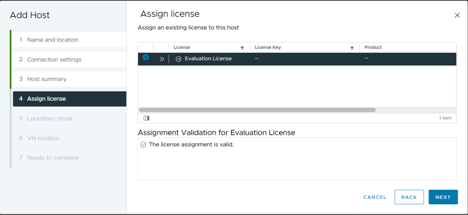

## 8. Configure Lockdown Mode

During host registration, select:

<strong>Disable Lockdown Mode</strong>

This was the configuration used in the original lab.

  
View screenshot

  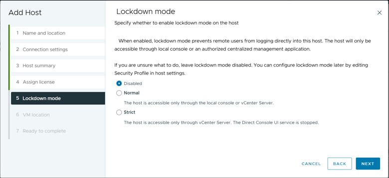

Continue through the wizard and select the <code>vSphere.lan</code> datacenter as the destination for the ESXi host.

  
View screenshot

  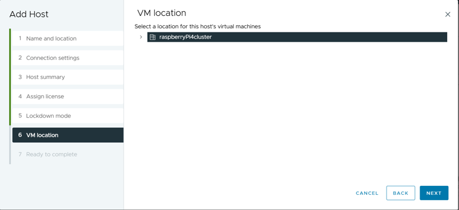

Review the configuration and select <strong>Finish</strong>.

  
View screenshot

  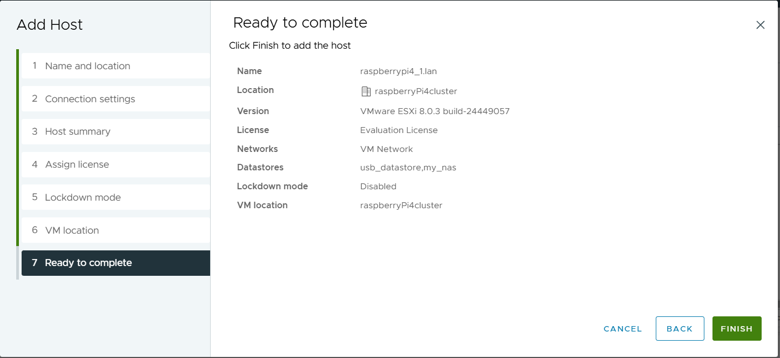

## 9. Add the remaining ESXi Hosts

Repeat the host registration procedure for the remaining three ESXi hosts.

Use the corresponding hostnames:

<table>
  <tr>
    <th>ESXi Host</th>
    <th>Hostname</th>
  </tr>
  <tr>
    <td>Raspberry Pi 4-1</td>
    <td>raspberrypi4_1.lan</td>
  </tr>
  <tr>
    <td>Raspberry Pi 4-2</td>
    <td>raspberrypi4_2.lan</td>
  </tr>
  <tr>
    <td>Raspberry Pi 4-3</td>
    <td>raspberrypi4_3.lan</td>
  </tr>
  <tr>
    <td>Raspberry Pi 4-4</td>
    <td>raspberrypi4_4.lan</td>
  </tr>
</table>

For each host:

1. Select the <code>vSphere.lan</code> datacenter.
2. Choose <strong>Add Hosts</strong>.
3. Enter the host's DNS name or IP address.
4. Provide the ESXi root credentials.
5. Select <strong>Evaluation License</strong>.
6. Select <strong>Disable Lockdown Mode</strong>.
7. Assign the host to the datacenter.
8. Finish the wizard.

Once all four hosts have been added, they should appear in the vSphere Client inventory.

## 10. Verify Host Registration

After adding all four hosts:

1. Review the inventory panel in the vSphere Client.
2. Confirm that all four ESXi hosts appear under <code>vSphere.lan</code>.
3. Select each host and verify that its status is visible in the inventory.
4. Confirm that the hosts can be managed through the centralized interface.

Successful registration demonstrates that vCenter can centrally manage the four ESXi hosts.

## 11. Attempt to Create a Cluster

After registering all four hosts, the next step in the original project was to attempt to create a cluster.

1. Right-click the datacenter created earlier (named raspberryPi4cluster in my case)
2. Select <strong>New Cluster</strong> or <strong>Add Cluster</strong>, depending on the interface option presented.
3. Follow the cluster creation workflow.

The intention was to group the four ESXi hosts into a single managed cluster.

However the clustering configuration did not produce a clustered result. Below is the documented attempt:

  
View screenshot

  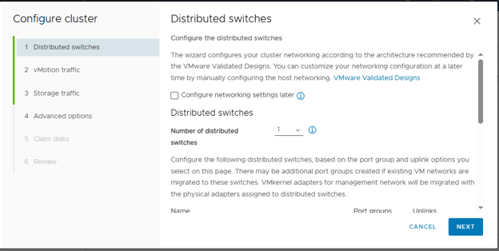

  
View screenshot

  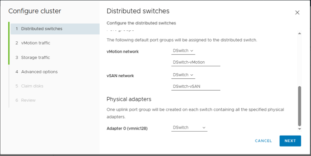

  
View screenshot

  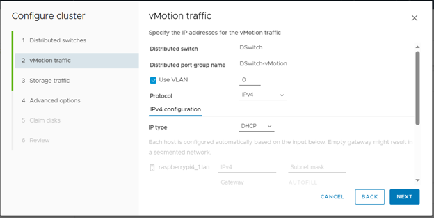

  
View screenshot

  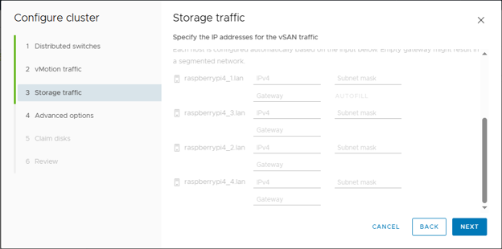

  
View screenshot

  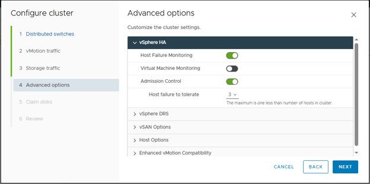

  
View screenshot

  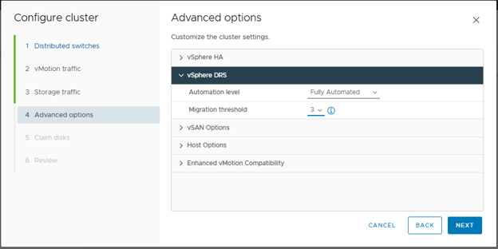

  
View screenshot

  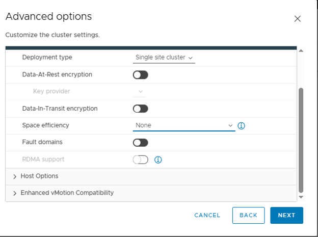

Allow the DHCP server to be the NTP server for Time Synchronization.

  
View screenshot

  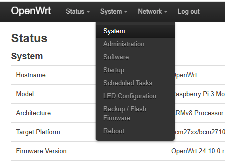

  
View screenshot

  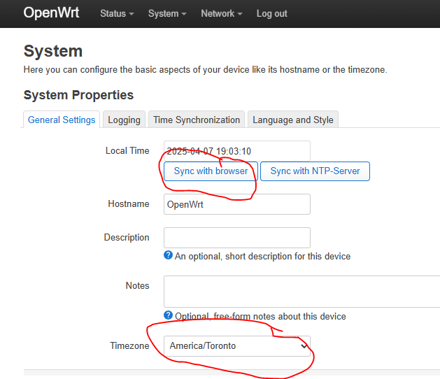

  
View screenshot

  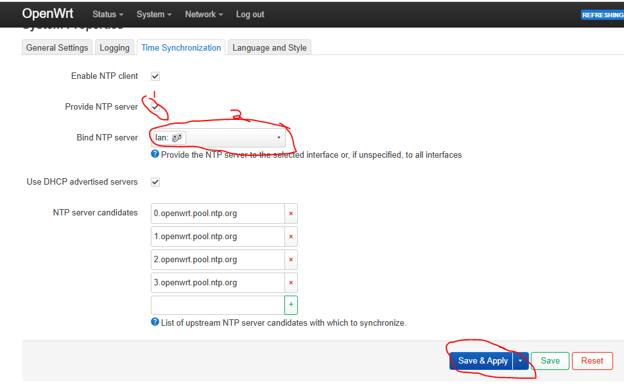

Return to vSphere and under Host Options designate the OpenWRT router as the NTP server. 

  
View screenshot

  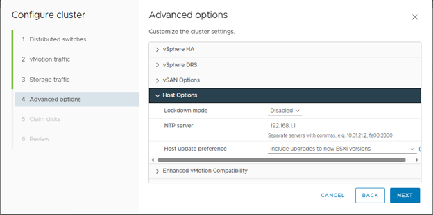

Next, there was a missing shared-storage/vSAN configuration for the cluster creation (possible oversight in previous cluster creation configuration steps).

  
View screenshot

  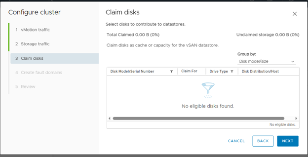

The intended storage arrangement involved separating storage for NAS use from storage intended for vSAN compatibility. This was the suspected cause recorded during the project, not a confirmed daignosis.

## 12. Project Notes and Limitations

The following summarizes the final state of this stage of the project:

- vCenter Server Appliance was successfully deployed.
- A datacenter named <code>raspberrypi4cluster</code> was created.
- Four Raspberry Pi ESXi hosts were registered in vCenter.
- Evaluation Licensing and disabled Lockdown Mode were selected during host registration.
- The hosts appeared in the centralized vSphere inventory.
- A cluster creation attempt was made but the clustering configuration was not completed.
- A working vSAN or clustered shared-storage environment was not achieved.

The successful registration of all four hosts demonstrated centralized management through vCenter, even though the final clustering objective remained incomplete.

## 13. Related Guides

- Guide 5 - OpenWRT DNS Configuration
- Guide 6 - Add a Datastore to VMware ESXi
- Guide 7 - OpenMediaVault NAS Installation and NFS Datastore Configuration
- Guide 10 - Deploying VMware vCenter Server Appliance
