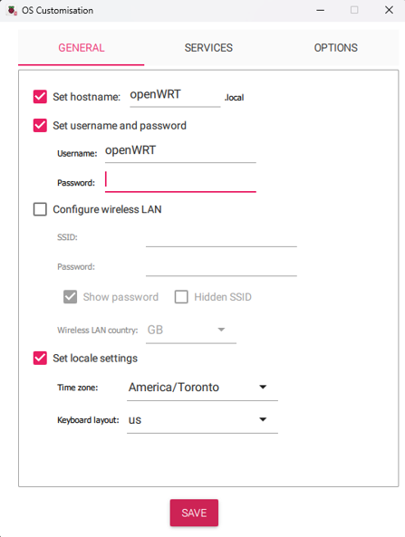
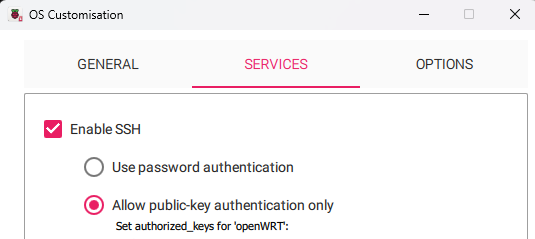
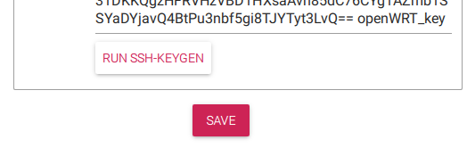
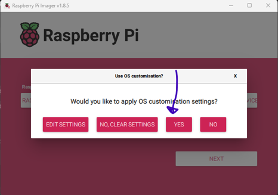
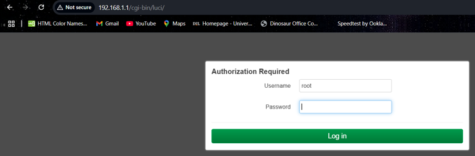
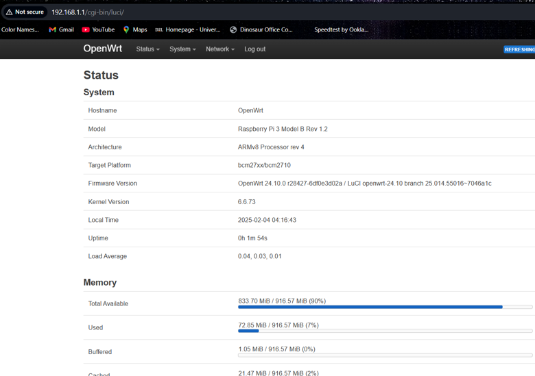

# OpenWRT Installation on Raspberry Pi

This guide documents the installation of OpenWRT on a Raspberry Pi for use as a DHCP and DNS server in a small virtualized lab environment. 

The original project used a Raspberry Pi 3 Model B to provide network services to the lab's virtualization hosts. The procedure below follows that reference setup; menu names and supported installation options may differ between software versions and Raspberry Pi Models; however, the steps will be similar for other Raspberry Pi Models.

## Objectives 

- Download an OpenWRT firmware image for the target Raspberry Pi.
- Write the firmware image to a microSD card.
- Prepare authentication settings where supported.
- Boot the Raspberry Pi into OpenWRT.
- Access the LuCI web interface.

## Prerequisites

- A compatible Raspberry Pi (Raspberry Pi 3 Model B in the original setup).
- A microSD card and compatible card reader.
- A computer with internet access.
- OpenWRT Firmware Selector.
- Raspberry Pi Imager
- An Ethernet cable and network switch,
- A computer with Ethernet connectivity for accessing the device.

<strong>Warning: </strong> Writing firmware to a storage device erases its existing contents. Confirm that the correct microSD card is selected before proceeding. Back up any data you need to retain.

## 1. Download the OpenWRT firmware image

1. Open the <a href="https://firmware-selector.openwrt.org/">OpenWRT Firmware Selector.</a>
2. Select the target device corresponding to your Raspberry Pi model.
   <details>
     <summary>View screenshot</summary>
      
     
   </details>

3. Locate the appropriate firmware image for that device.
4. Choose the image type. <strong>SquashFS</strong> and <strong>ext4</strong> were the main filesystem image types. If additional package installation, services and/or filesystem flexibilty were priorities, ext4 would be preferred. The original setup primarily needed DHCP and DNS services so <strong>SquashFS</strong> was sufficient.

   <details>
     <summary>View screenshot</summary>
      
     
   </details>
5. Download the image to your computer.

If you are unsure which Raspberry Pi model you have, check the device's model information before selecting firmware. Firmware images are hardware-specific, so do not assume that an image for one model will work on another.

Also, choose an image supported by your device and appropriate for your intended use. Confirm the exact image type and filename in the Firmware Selector before downloading.

## 2. Open Raspberry Pi Imager

1. Insert microSD card into your computer. Use an adapter if needed.
2. Launch Raspberry Pi Imager.
3. Open <strong>Choose Device</strong>
4. Select the Raspberry Pi model matching your hardware.
   <details>
     <summary>View screenshot</summary>
      
     
   </details>

The original setup used a Raspberry Pi 3 Model B. Select the model you are actually configuring.

## 3. Select the OpenWRT image

1. Open <strong>Choose OS</strong>
   <details>
     <summary>View screenshot</summary>
      
     
   </details>
2. Scroll down and select <strong>Use custom</strong>
   <details>
     <summary>View screenshot</summary>
      
     
   </details>
3. Browse to the OpenWRT firmware image downloaded in Step 1.
4. Select the image and confirm that the chosen file matches your target device.
   <details>
     <summary>View screenshot</summary>
      
     
   </details>

The downloaded filename may differ from the one shown in the screenshot. This is expected if the firmware version or image naming convention has changed.

## 4. Select the microSD card

1. Open <strong>Choose Storage</strong>
2. Identify the microSD card by its name and capacity.
3. Select the correct card.
4. Review the selected device before continuing.

<strong>Important: </strong> Raspberry Pi Imager will overwrite the selected storage device. Do not proceed unless you have confirmed that the target is the intended microSD card.

## 5. Configure authentication settings

The original procedure included an OS customization step for setting a password and adding an SSH public key before writing the image.

1. Open <strong>Edit Settings</strong> if Raspberry Pi Imager offers supported customization options for the selected image.
   <details>
     <summary>View screenshot</summary>
      
     
   </details>
2. Configure a strong, unique administrative password if the image workflow supports it. Below is my python code that uses the cryptographically secure <strong>secrets</strong> module. If you are not using this, whatever password you select, I suggest making sure it doesn't exist in the rockyou.txt rainbow table that exists that can crack passwords. Here is the sample code:

### Generating a Secure Password with Python
Before configuring the OpenWRT image, you can generate a strong password using Python's secrets module. Unlike random, secrets is designed for security-sensitive applications and uses a cryptographically secure source of randomness.

The following script generates a password with a minimum length of 16 characters, using uppercase and lowercase letters, digits, and punctuation.

```python
import secrets
import string

# Define the characters available in the password.
charset = string.ascii_letters + string.digits + string.punctuation

# Request a password length.
while True:
    try:
        length = int(input("Enter password length (minimum 16): "))

        if length < 16:
            print("Please enter a length of at least 16 characters.")
            continue

        break
    except ValueError:
        print("Invalid input. Please enter a positive integer.")

# Generate the password using a cryptographically secure source.
password = ''.join(secrets.choice(charset) for _ in range(length))

print(f"\nGenerated password: {password}")
```

#### How to use it:
A. Save the code in a file named <code>generate_password.py</code>

B. Run it with Python (use the following command after navigating to the folder this file is contained in terminal or click Run if using a Python interpreter like Pycharm with the file open):
   <code> python generate_password.py</code>

C. Enter the desired password length when prompted.

D. Copy the generated password into the password field in Raspberry Pi Imager's customization settings.

<strong>Note:</strong> if you use this code, DO NOT STORE YOUR PASSWORD IN A PUBLICLY ACCESSIBLE REPOSITORY

#### Security considerations:
- Use a password manager to store the generated password securely.
- Never commit a reail password or other credentials to GitHub.
- This script selects from the combined character set but does not guarantee that every character category appears in each password.
- The Raspberry Pi Imager customization workflow depends on the firmware image and software version; verify that your selected OpenWRT image supports the settings you configure.

## Back to Raspberry Pi Imager
3. Once you've created your password, paste it here in the general tab of the OS Customization section:



4. If configuring SSH public-key authentication, generate a key pair on your own computer and provide only the public key. Go to the <strong>Services</strong> tab on the Raspberry Pi Imager. From here select <strong>Enable SSH</strong> and select <strong>Allow public-key authentication only</strong>

<details>
   <summary>View screenshot</summary>

   
</details>

### Generating an SSH Key Pair

SSH (Secure Shell) allows you to manage a device remotely through an encrypted connection. SSH keys provide an alternative to password-based authentication. 

An SSH key pair consists of two files:
- <strong>Private key:</strong> Remains on your computer. Never share it or upload it to Github.
- <strong>Public key:</strong> Can be installed on the Raspberry Pi to authenticate SSH connections.

For this lab we wll generate a new SSH key pair dedicated to the OpenWRT setup.

A. Open a terminal

On Windows, open <strong>Powershell</strong> or <strong>Windows Terminal</strong>. On macOS or Linux, open your terminal application.
The commands below will work with a standard OpenSSH installation.

B. Generate the SSH key pair

Run the following command:
<code>ssh-keygen -t ed25519 -C "openwrt-lab"</code>

Follow the prompts:

-> When asked where to save the key, enter a filename for this lab-specific key pair. For example, use 
~/.ssh/openwrt_lab.

-> When asked for a passphrase, enter one to protect your private key. You can leave it empty but using a passphrase provides additional protection. 

-> Confirm the passphrase if prompted.

The resulting files will be:
- Private key: ~/.ssh/openwrt_lab
- Public key: ~/.ssh/openwrt_lab.pub

If you choose a different filename or directory, use that location in the following steps.

C. Display and copy the public key

On Windows PowerShell:
<code>Get-Content ~/.ssh/openwrt_lab.pub</code>

On macOS or Linux:
<code>cat ~/.ssh/openwrt_lab.pub</code>

Copy the entire output. It should be one line beginning with ssh-ed25519, followed by an encoded string and the comment openwrt-lab. 

<strong>Only copy the public key file ending in .pub. Never share or upload the private key.</strong>

D. Add the public key in Raspberry Pi Imager

In Raspberry Pi Imager's customization settings, paste the copied public key into the SSH public key field, if available for the selected image and Imager version. It'll look similar to the screenshot below (note I used openWRT_key as the filename):

<details>
   <summary>View screenshot</summary>

   
</details>

Configure the remaining settings, including the username and password, as appropriate for the OpenWRT image. Write the image to the microSD card and boot the Raspberry Pi with the SD Card inserted. 

<details>
   <summary>View screenshot</summary>

   
</details>

E. Verify SSH access

Once the Raspberry Pi has booted and is connected to the network switch via Ethernet cable, try connecting to it via your computer that is also connected via ethernet to the switch. 

<code>ssh -i ~/.ssh/openwrt_lab <username>@192.168.1.1</code>

Replace <username> with the account configured for your image. On Windows, the same command works in PowerShell or Windows Terminal when OpenSSH is installed. 

The exact username, SSH service configuration, and authentication behaviour depend on the OpenWRT image and its first-boot configuration. IF the connection fails, verify that SSH is enabled, the public key was installed correctly, and the username and IP address are correct. 

# Back to earlier steps 
## 5. Connect and boot the Raspberry Pi

1. Insert the prepared microSD card with OpenWRT on it into the Raspberry Pi.
2. Connect the Raspberry Pi to the network switch using Ethernet.
3. Connect your computer to the same switch.
4. Power on the Raspberry Pi and allow it time to boot.

Note you will most likely need to disable wifi connections on your computer so there is no conflict between your ISP router's DHCP addressing and the router we are setting up via the OpenWRT image. 

## 6. Access the LuCI web interface

1. Open a web browser on the computer connected to the same network.
2. Navigate to http://192.168.1.1 if the device is using the original procedure's default address.
3. Sign in using the crednetials configured for your installation.

The original setup used 192.168.1.1 to access the LuCI interface. If the interface is unreachable, verify the computer's network connection, the Raspberry Pi's boot status, and the device's current IP configuration.



After inputting the login credentials, you should see the following: 




