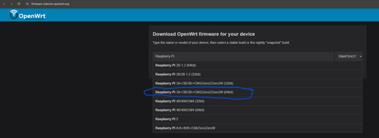
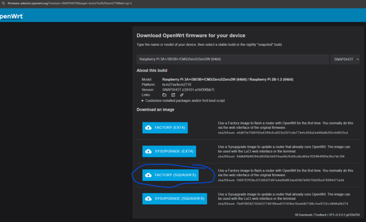
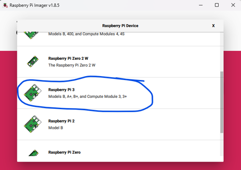
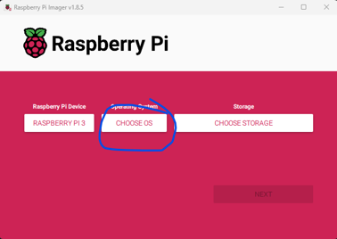
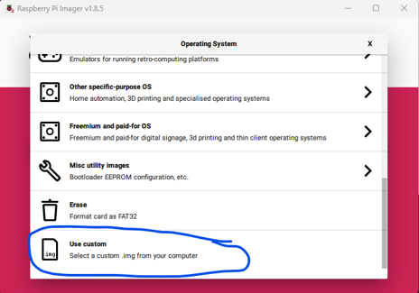
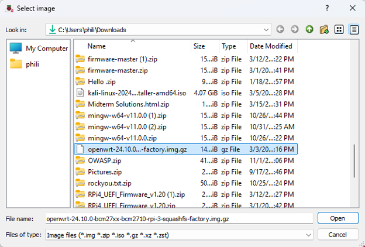
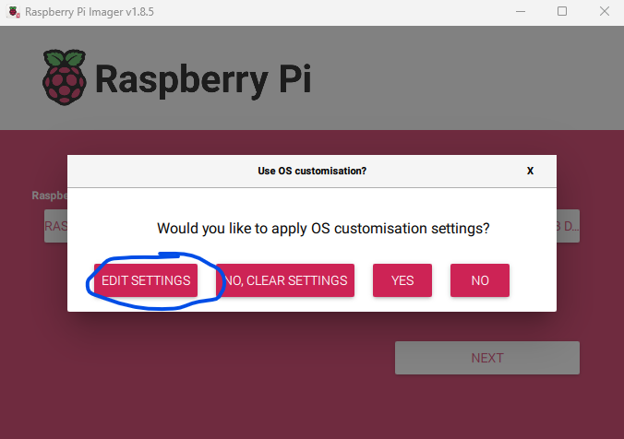

# OpenWRT Installation on Raspberry Pi

This guide documents the installation of OpenWRT on a Raspberry Pi for use as a DHCP and DNS server in a small virtualized lab environment. 

The original project used a Raspberry Pi 3 Model B to provide network services to the lab's virtualization hosts. The procedure below follows that reference setup; menu names and supported installation options may differ between software versions and Raspberry Pi Models; however, the steps will be similar for other Raspberry Pi Models.

## Objectives 

- Download an OpenWRT firmware image for the target Raspberry Pi.
- Write the firmware image to a microSD card.
- Prepare authentication settings where supported.
- Boot the Raspberry Pi into OpenWRT.
- Access the LuCI web interface.

## Prerequisites

- A compatible Raspberry Pi (Raspberry Pi 3 Model B in the original setup).
- A microSD card and compatible card reader.
- A computer with internet access.
- OpenWRT Firmware Selector.
- Raspberry Pi Imager
- An Ethernet cable and network switch,
- A computer with Ethernet connectivity for accessing the device.

<strong>Warning: </strong> Writing firmware to a storage device erases its existing contents. Confirm that the correct microSD card is selected before proceeding. Back up any data you need to retain.

## 1. Download the OpenWRT firmware image

1. Open the <a href="https://firmware-selector.openwrt.org/">OpenWRT Firmware Selector.</a>
2. Select the target device corresponding to your Raspberry Pi model.
   

     
View screenshot

      
     
   

3. Locate the appropriate firmware image for that device.
4. Choose the image type. <strong>SquashFS</strong> and <strong>ext4</strong> were the main filesystem image types. If additional package installation, services and/or filesystem flexibilty were priorities, ext4 would be preferred. The original setup primarily needed DHCP and DNS services so <strong>SquashFS</strong> was sufficient.

   

     
View screenshot

      
     
   

5. Download the image to your computer.

If you are unsure which Raspberry Pi model you have, check the device's model information before selecting firmware. Firmware images are hardware-specific, so do not assume that an image for one model will work on another.

Also, choose an image supported by your device and appropriate for your intended use. Confirm the exact image type and filename in the Firmware Selector before downloading.

## 2. Open Raspberry Pi Imager

1. Insert microSD card into your computer. Use an adapter if needed.
2. Launch Raspberry Pi Imager.
3. Open <strong>Choose Device</strong>
4. Select the Raspberry Pi model matching your hardware.
   

     
View screenshot

      
     
   

The original setup used a Raspberry Pi 3 Model B. Select the model you are actually configuring.

## 3. Select the OpenWRT image

1. Open <strong>Choose OS</strong>
   

     
View screenshot

      
     
   

2. Scroll down and select <strong>Use custom</strong>
   

     
View screenshot

      
     
   

3. Browse to the OpenWRT firmware image downloaded in Step 1.
4. Select the image and confirm that the chosen file matches your target device.
   

     
View screenshot

      
     
   

The downloaded filename may differ from the one shown in the screenshot. This is expected if the firmware version or image naming convention has changed.

## 4. Select the microSD card

1. Open <strong>Choose Storage</strong>
2. Identify the microSD card by its name and capacity.
3. Select the correct card.
4. Review the selected device before continuing.

<strong>Important: </strong> Raspberry Pi Imager will overwrite the selected storage device. Do not proceed unless you have confirmed that the target is the intended microSD card.

## 5. Configure authentication settings

The original procedure included an OS customization step for setting a password and adding an SSH public key before writing the image.

1. Open <strong>Edit Settings</strong> if Raspberry Pi Imager offers supported customization options for the selected image.
   

     
View screenshot

      
     
   

2. Configure a strong, unique administrative password if the image workflow supports it. Below is my python code that uses the cryptographically secure <strong>secrets</strong> module. If you are not using this, whatever password you select, I suggest making sure it doesn't exist in the rockyou.txt rainbow table that exists that can crack passwords. Here is the sample code:

<code>
import secrets
import string

##### Define the characters available in the password.
charset = string.ascii_letters + string.digits + string.punctuation

##### Request a password length.
while True:
    try:
        length = int(input("Enter password length (minimum 16): "))

        if length < 16:
            print("Please enter a length of at least 16 characters.")
            continue

        break
    except ValueError:
        print("Invalid input. Please enter a positive integer.")

##### Generate the password using a cryptographically secure source.
password = ''.join(secrets.choice(charset) for _ in range(length))

print(f"\nGenerated password: {password}")
</code>

<strong>Note:</strong> if you use this code, DO NOT STORE YOUR PASSWORD IN A PUBLICLY ACCESSIBLE REPOSITORY

