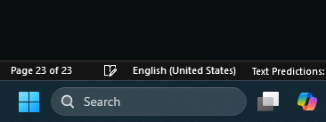
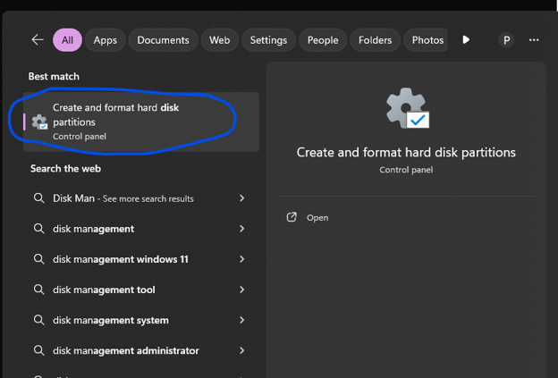
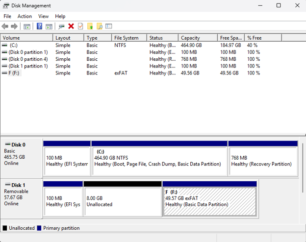
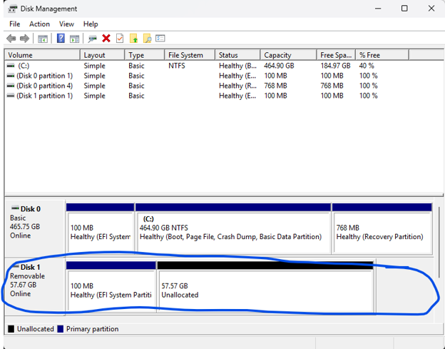
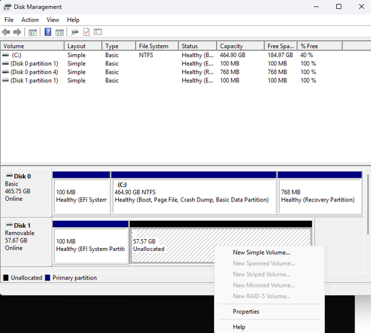
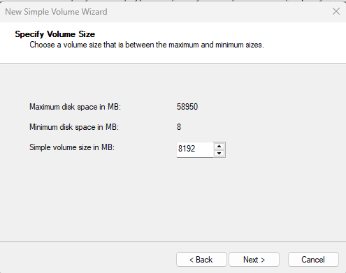

# USB Storage Preparation for ESXi

## Overview

This guide explains how to prepare a USB storage device for use with the VMware ESXi by creating two separate partitions. 

The purpose of this configuration is to separate the ESXi boot and host files from the remaining storage capacity, allowing the rest of the drive to be used for virtual machine storage.

<strong>Important:</strong> This guide prepares the USB storage device in Windows. It does not install ESXi or configure the VMFS datastore. Those steps are covered separately. 

Also, this document will be referenced in later guides.

## Prerequisites

Before beginning, ensure you have: 

- A USB storage device with sufficient capacity for both partitions (64 GB or more).
- A Windows computer.
- Access to Windows Disk Management.
- Any important files on the USB device backed up elsewhere.

For this configuration, a larger USB drive is preferable because the second partition will use the remaining capacity after reserving 8 GB for ESXi.

## 1. Open Windows Disk Management

1. Connect the USB storage device to your computer.
2. Open the Windows taskbar search (usually bottom left of Windows desktop).

  
View screenshot

  

3. Type <code>Disk Management</code>
4. Select <strong>Create and format hard disk partitions</strong>

  
View screenshot

  

Windows Disk Management displays the connected storage devices, their partitions, and available space.

## 2. Identify the USB Drive and Delete Existing Partitions

⚠️ <strong>WARNING: THIS OPERATION CAN PERMANENTLY ERASE DATA </strong>

Disk Management can be used to delete partitions and format entire storage devices, including your computer's internal system drive. 

Before proceeding, carefully identify your USB storage device by its capacity and existing drive letter. Do not rely on the disk number shown in the original screenshots, as it will vary between computers.

1. Locate your USB drive in the lower section of Disk Management.
2. Verify that you have selected the correct device.

  
View screenshot

  

3. If the device contains existing volumes, right-click each applicable volume and select <strong>Delete Volume</strong>.
4. Confirm the deletion if prompted.

Once the existing volumes have been deleted, the available space should appear as unallocated.

  
View screenshot

  

<strong>Note: </strong>Windows may display a small reserved area on the device. The available partition space may therefore be slightly smaller than the advertised capacity of the USB drive. In my case, there is a 100MB Partition reserved for the USB drive's internal mechanisms for formatting which cannot be used to store files.

## 3. Create the First Partition

The first partition will be 8 GB and reserved for the ESXi boot and host files.

1. Right-click the unallocated space on the USB device.
2. Select <strong>New Simple Volume</strong>

  
View screenshot

  

3. When prompted for the volume size, enter 8192 MB.

  
View screenshot

  

4. Click <strong>Next</strong>.

