# ESXi Installation on Raspberry Pi 4

## Overview

This guide documents the installation of VMware ESXi ARM on a Raspberry Pi 4. It covers preparing the microSD card with the required Raspberry Pi firmware and UEFI bootloader, creating an ESXi installation USB, configuring the UEFI settings, and installing the hypervisor onto a separate USB storage device.

The objective is to configure the Raspberry Pi to boot directly into ESXi, allowing it to host ARM64 virtual machines. 

The original project used multiple Raspberry Pi 4 devices as ESXi hosts. 

<strong>Important:</strong> These instructions reflect the original project environment and the ESXi ARM Fling available at the time of implementation. Firmware, installer availability, compatibility, and installation procedures may differ with newer software versions.

## 1. Prerequisites

Before beginning, prepare the following: 

### Hardware

- Raspberry Pi 4 Model B
- microSD card
- USB storage device for the ESXi Installer (16-32 GB)
- Separate USB storage device for the ESXi Installation (16-64 GB or larger)
- Monitor and micro-HDMI to HDMI cable or adapter
- USB keyboard
- Ethernet connection
- Computer with an internet connection and USB ports

The microSD card stores the Raspberry Pi firmware and UEFI bootloader. ESXi itself will be installed on a separate USB storage device.

For multiple Raspberry Pi hosts, repeat the preparation and installation process for each device. Each Raspberry Pi requires its own boot media and ESXi installation storage.

### Software

- Raspberry Pi Imager
- Raspberry Pi firmware
- Raspberry Pi 4 UEFI firmware from the Project Firmware repository.
- VMware ESXi ARM Fling Installer
- Rufus (Windows) or balenaEtcher (macOS/Linux)

### Related Guides

- <a href="https://github.com/philio1327/raspberry_pi_virtualization_lab/blob/main/docs/Guide%201%20-%20Raspberry%20Pi%20Boot%20Configuration.md">Raspberry Pi Boot Configuration</a>
- <a href="https://github.com/philio1327/raspberry_pi_virtualization_lab/blob/main/docs/Guide%202%20-%20OpenWRT%20Installation.md">OpenWRT Installation on Raspberry Pi</a>
- <a href="https://github.com/philio1327/raspberry_pi_virtualization_lab/blob/main/docs/Guide%203%20-%20USB%20Storage%20Preparation%20for%20ESXi.md">USB Storage Preparation</a>

## 2. Prepare the microSD Card for ESXi

The microSD card will contain the Raspberry Pi firmware and UEFI bootloader required to initialize the hardware and launch ESXi.

### 2.1 Install Raspberry Pi OS

1. Download and install <a href="https://www.raspberrypi.com/software/">Raspberry Pi Imager</a>, if you haven't already.

  
View screenshot

  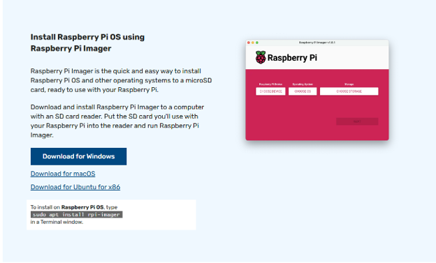

2. Insert a microSD card into your computer using an SD card reader or USB adapter.

  
View screenshot

  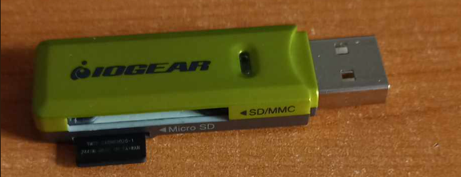

3. Open Raspberry Pi Imager.
4. Select the appropriate Raspberry Pi device. For this project, select Raspberry Pi 4.

  
View screenshot

  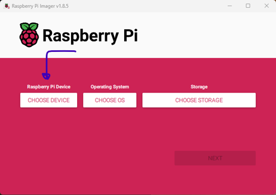

  
View screenshot

  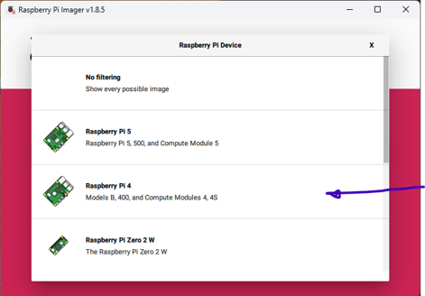

5. Under <strong>Choose OS</strong>, select Raspberry Pi OS Lite (64-bit).

  
View screenshot

  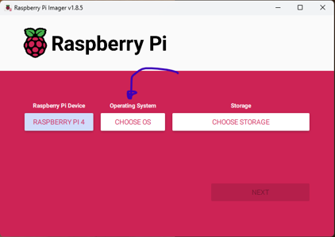

  
View screenshot

  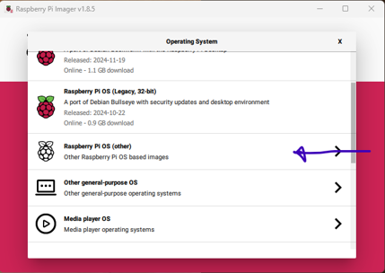

  
View screenshot

  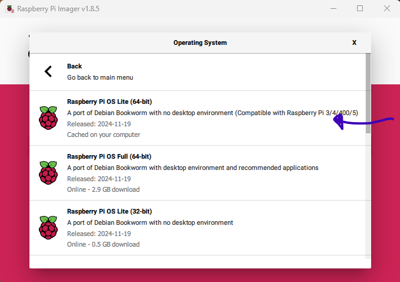

6. Select the correct microSD card under <strong>Choose Storage</strong>.

  
View screenshot

  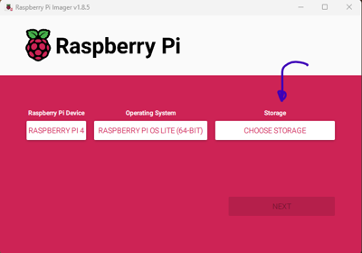

  
View screenshot

  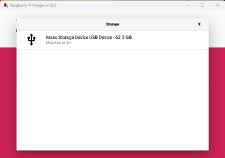

7. Review the selected device carefully before writing.

The purpose of this installation is to update the Raspberry Pi and its EEPROM bootloader. Raspberry Pi OS will be erased later in the procedure. 

⚠️ <strong>Warning</strong>: Writing an operating system to the microSD card erases its existing contents. Verify that you have selected the correct storage device. 

Note: You can add in SSH Keys and other authentication controls such as a password for the Rasbian Lite OS; however it is unnecessary as this OS will be overwritten. 

<strong>Ensure you disable the wifi under Edit Settings before writing to this microSD card</strong>

### 2.2 Boot the Raspberry Pi and Update the System 

1. Safely eject the microSD card from your computer.
2. Insert it into the Raspberry Pi.

  
View screenshot

  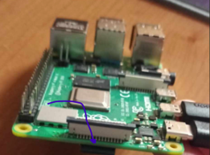

3. Connect a monitor and keyboard to the Raspberry Pi.

  
View screenshot

  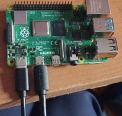

4. Connect the Raspberry Pi to the internet using Ethernet.

  
View screenshot

  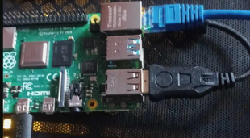

5. Power on the Raspberry Pi and complete the initial Raspberry Pi OS setup.
6. Update the operating system and bootloader EEPROM.
   To do this, once Raspberry Pi has booted, and you've logged in using your login credentials (it may ask you to create new credentials on first boot, or you can use username "root" when prompted and leave the password blank, though it may ask you to provide a password).
   
   Ensure you have an internet connection by using the command: <code>ping google.com</code>

  
View screenshot

  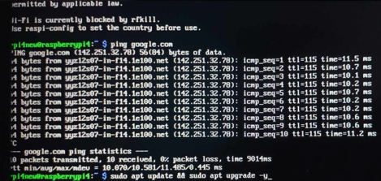

   Then update your Raspberry Pi using:
   <code>sudo apt update && sudo apt upgrade -y</code>

   Note: You can omit sudo if you are the root user.

   Then,
   
   <code>sudo apt full-upgrade</code>
   
   <code>sudo rpi-update</code>

  
View screenshot

  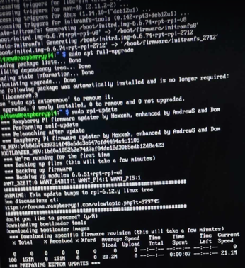

   Then finally the following commands:
   
   <code>sudo rpi-eeprom-update -a</code>
   
   <code>sudo reboot</code>

  
View screenshot

  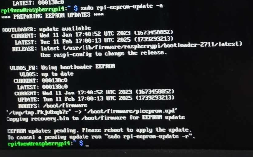

### 2.3 Verify the Bootloader

Once the update and reboot are complete, sign in to your Raspberry Pi using the credentials you configured and verify that the bootloader installed correctly. Use the following command:
<code>sudo rpi-eeprom-update -a</code>

  
View screenshot

  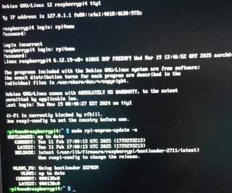

Then <strong>sudo reboot</strong> and once the Raspberry Pi is on, unplug the power source to the Raspberry Pi and remove the SD card. 

### 2.4 Erase the microSD Card

Once the firmware and EEPROM updates are complete, the Raspberry Pi OS installation is no longer required. 

1. Remove the microSD card and connect it to your computer.
2. Open the Raspberry Pi Imager.
3. Select the correct Raspberry Pi device.

  
View screenshot

  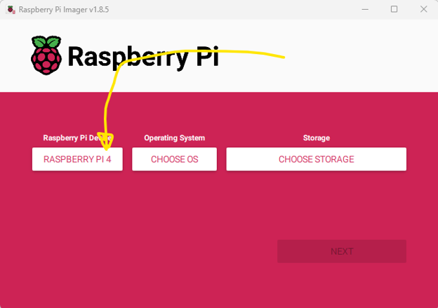

  
View screenshot

  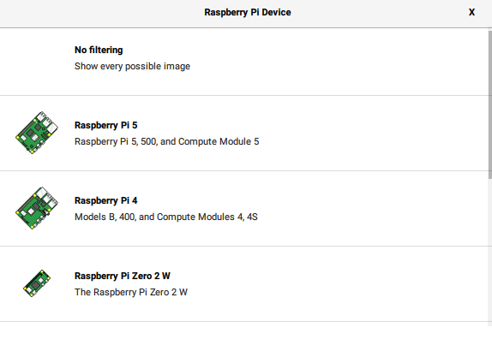

4. Under <strong>Choose OS</strong>, scroll down and select <strong>Erase</strong>.

  
View screenshot

  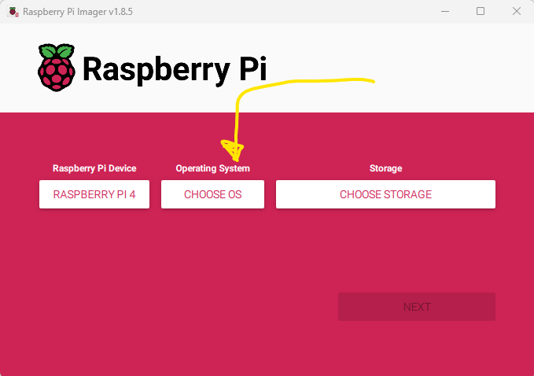

  
View screenshot

  
  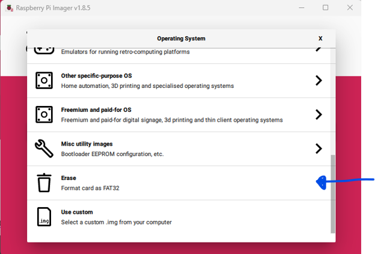

5. Select the microSD card as the storage device.

  
View screenshot

  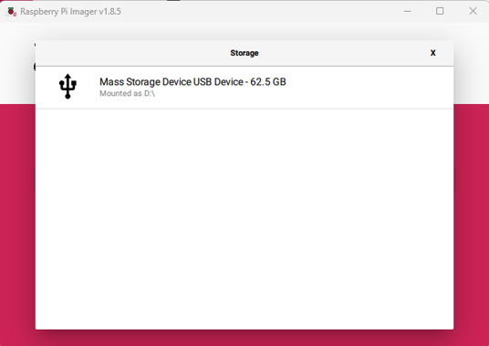

6. Confirm the operation and wait for the erase process to complete.

This reformats the microSD card in preparation for copying the Raspberry Pi firmware and UEFI files.

⚠️ <strong>Verify the selected storage device before confirming. This operation erases the selected card.</strong>

### 2.5 Download Raspberry Pi Firmware and UEFI Firmware

Two separate firmware packages are required:

1. <strong>Raspberry Pi Firmware</strong>: Provides the files required to initialize and boot the Raspberry Pi hardware.
2. <strong>UEFI Firmware</strong>: Provides the UEFI environment required to boot the ESXi installer.

The original project used the following sources:
- Raspberry Pi Firmware: <a href="https://bit.ly/2HpIaG6">Raspberry Pi Firmware Repository</a>
- Raspberry Pi 4 UEFI Firmware: <a href="https://github.com/pftf/RPi4/releases/">Project Firmware - Raspberry Pi 4 Releases</a>

Download the appropriate versions and extract both archives. 

  
View screenshot

  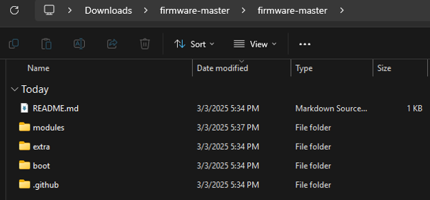

<strong>Compatibility Note</strong>: Use firmware versions appropriate for your Raspberry Pi model and the ESXi ARM build. The original project used Raspberry Pi 4 hardware. The original document also identified compatibility problems with Raspberry Pi 5, and those issues have since been resolved.

### 2.6 Copy the Raspberry Pi Firmware Files

After extracting the Raspberry Pi archive:

1. Open the extracted <code>firmware-master</code> directory.
2. Navigate to: <code>firmware/boot</code>
3. Copy the contents of the <code>boot</code> folder to the root of the microSD card.

  
View screenshot

  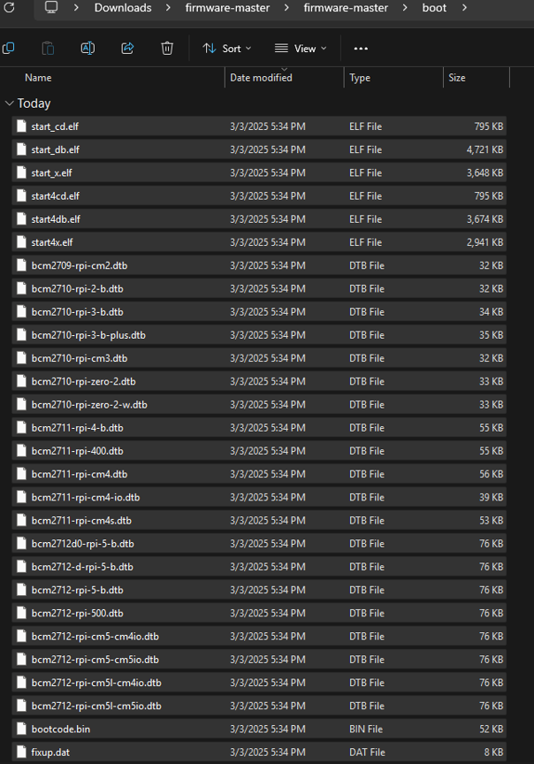

4. If Windows reports duplicate files, skip the duplicates. 

### 2.7 Remove Kernel Image Files

Navigate to the root of the microSD card.

Delete the <code>kernel.img</code> image files identified in the original procedure

  
View screenshot

  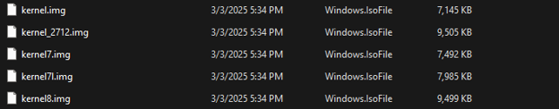

### 2.8 Copy the UEFI Firmware Files

1. Open the extracted Raspberry Pi 4 UEFI firmware directory.
2. Select all files and folders inside it.
3. Copy them to the root of the microSD card.
4. If Windows reports duplicate files, replace the existing files with the new ones.

  
View screenshot

  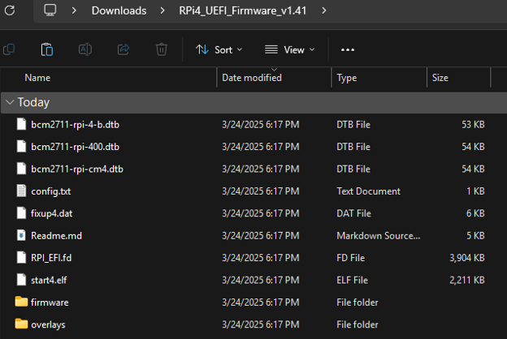

### 2.9 Modify <code>config.txt</code>

Open the <code>config.txt</code> file located on the microSD card.

Add the following line at the end of the file:

<code>gpu_mem=16</code>

Save the file and safely eject the microSD card. 

The microSD card is now prepared with the Raspberry Pi Firmware and UEFI bootloader required for the ESXi Installation process. 

  
View screenshot

  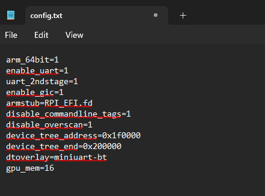

## 3. Prepare the ESXi Installation USB

The next step is to write the ESXi ARM Installer image to a separate USB Storage device.

### 3.1 Download the ESXi ARM Installer 

The original project used the VMware ESXi ARM Fling.

The historical download source was the following link: 

<a href="https://community.broadcom.com/flings/home">VMware Flings - Broadcom</a>

You will need to create an account and then access to the Flings will be granted. 

Download the appropriate ESXi ARM installer package and extract the downloaded archive to access the ISO image.

  
View screenshot

  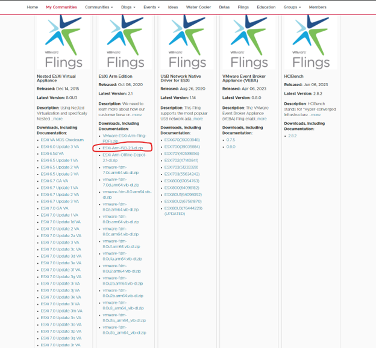

<strong>Note</strong>: The availability and distribution of historical Fling downloads may change. Confirm that you have a compatible installer before proceeding.

### 3.2 Download an Imaging Tool

The original procedure used Rufus on Windows. 
- <a href="https://rufus.ie/en/">Rufus</a>

For macOS and Linux, balenaEtcher is recommended:
- <a href="https://etcher.balena.io/">balenaEtcher</a>

The following steps will use Rufus.

Download the appropriate one for your version of Windows (go to taskbar and type About to see what type of Processor your Windows OS is running on):

  
View screenshot

  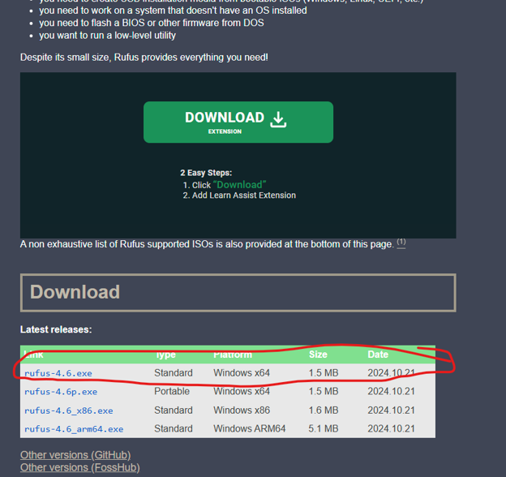

### 3.3 Write the ESXi ISO to USB using Rufus

1. Insert a USB storage device (16-32 GB) into your computer.
2. Open Rufus.
3. Under <strong>Device</strong>, select the USB device intended for the ESXi installer.
4. Under the <strong>Boot selection</strong>, click <strong>SELECT</strong>.

  
View screenshot

  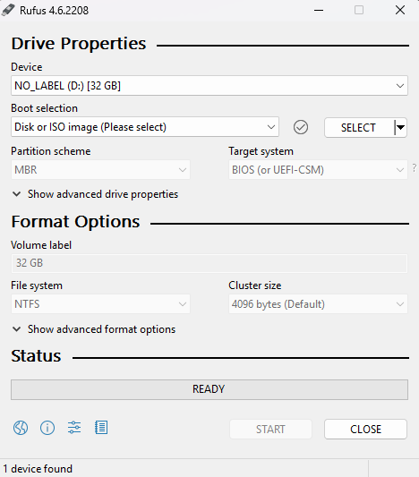

5. Navigate to the extracted ESXi ARM ISO image.

  
View screenshot

  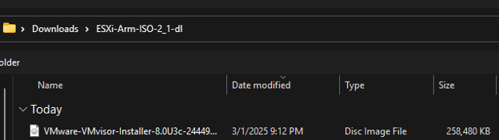

6. Select the ISO image.

<strong>Warning</strong>: This is a destructive operation. Rufus will erase and reformat the selected USB device. Back up any important files before continuing. 

### 3.4 Configure the Partition Scheme and Cluster Size

The original project used the following Rufus settings:

Partition scheme: GPT
Cluster Size: 32 kB

The original instructions explicitly specified GPT rather than MBR. Once the settings are configured, click <strong>Start</strong> and allow Rufus to write the image to the USB device. When complete, safely eject the USB drive.

  
View screenshot

  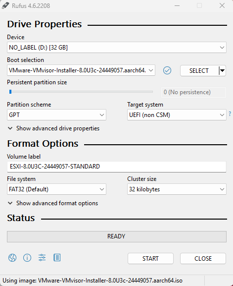

## 4. Connect the Installation Hardware

Before powering on the Raspberry Pi, connect the required hardware. 

- Raspberry Pi 4
- Prepared microSD card.
- USB drive containing the ESXi installer.
- Monitor connected through micro-HDMI.
- USB keyboard.
- Ethernet connection. 

  
View screenshot

  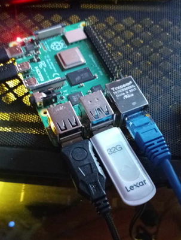

In image, cables left to right are:
- Power Cable
- microHDMI to HDMI to monitor
- USB keyboard
- Lexar USB with ESXi VMware ISO
- Ethernet cable for internet connection

Insert the prepared microSD card into the Raspberry Pi and connect the ESXi installer USB. The Raspberry Pi should remain powered off until all connections are complete.

## 5. Enter the UEFI Configuration Menu

1. Power on the Raspberry Pi.
2. As the Raspberry Pi starts, repeatedly press <strong>ESC</strong> on the connected keyboard.

  
View screenshot

  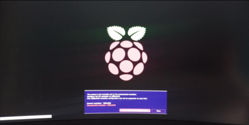

3. Enter the UEFI configuration interface.

  
View screenshot

  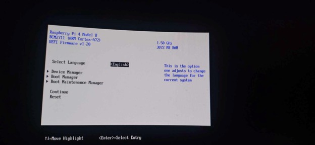

The UEFI menu provides access to the boot settings and hardware configuration needed for ESXi. If you do not get to above screen after repeatedly pressing ESC, you have missed the time window and must power down the Raspberry Pi (unplug it) wait 10 seconds and power on again. 

## 6. Disable the RAM Limiter 

The original procedure identified a memory limitation in the UEFI configuration. The default configuration exposed approximately 3 GB of RAM to the hypervisor, even when the Raspberry Pi had more physical memory installed. 

The limiter was disabled to allow ESXi to use the available system memory. 

### 6.1 Open Device Manager

Using the keyboard arrows, navigate to <strong>Device Manager</strong> and press Enter. 

### 6.2 Open Raspberry Pi Configuration

Navigate to <strong>Raspberry Pi Configuration</strong> and press Enter. 

  
View screenshot

  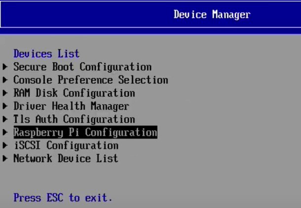

### 6.3 Open Advanced Configuration

Select <strong>Advanced Configuration</strong>

  
View screenshot

  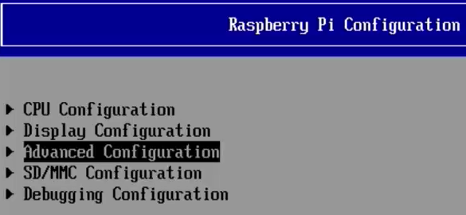

### 6.4 Disable the Limiter

1. Highlight the first configuration entry and hit Enter.

  
View screenshot

  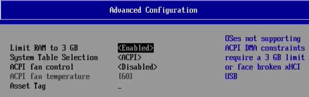

2. Change the setting to disabled (highlight disabled and hit Enter)

  
View screenshot

  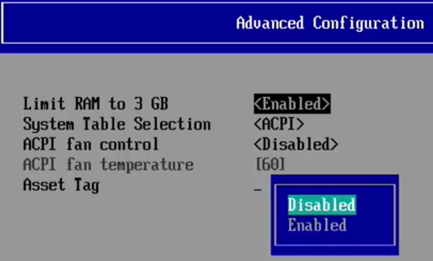

3. Please F10 to save the changes.
4. Press Y to confirm.

### 6.5 Return to the Main Menu and Reboot

1. Press ESC repeatedly until you return to the language selection screen.

  
View screenshot

  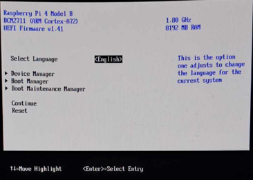

2. Highlight <strong>Continue</strong>.

  
View screenshot

  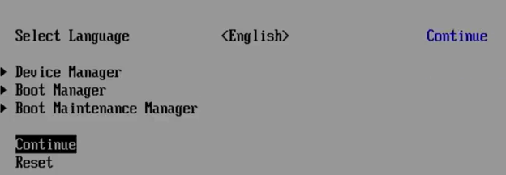

3. Press Enter to apply the configuration changes.
4. Allow the Raspberry Pi to reboot.
5. Once it restarts, repeatedly press ESC to return to the UEFI interface.

The memory limiter configuration is now updated. 

## 7. Boot the ESXi Installer

The ESXi Installer is stored on the USB device created in Section 3.

### 7.1 Open Boot Manager

From the UEFI configuration interface, navigate to <strong>Boot Manager</strong>.

  
View screenshot

  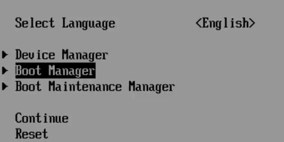

### 7.2 Select the ESXi Installer USB

Select the USB drive containing the ESXi installer. DO NOT PRESS ENTER BEFORE READING NEXT STEP.

  
View screenshot

  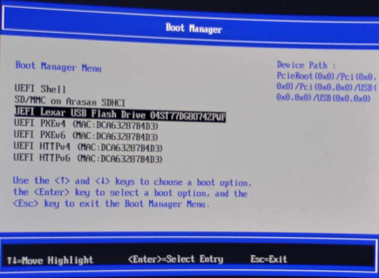

Your USB should appear above UEFI PXEv4 network boot option. 

### 7.3 Open the ESXi Boot Options

After selecting the USB device, repeatedly press <strong>Shift + O</strong>.

The ESXi boot command line should appear. 

If the timing is missed and the installer proceeds without allowing the required boot parameter to be entered, restart the Raspberry Pi and repeat the boot selection procedure. Your screen will look half yellow if you missed the timing.

### 7.4 Limit the ESXi OS Partition

At the boot command line, enter:

<code>autoPartitionOSDataSize=8192</code>

Press Enter to continue. 

  
View screenshot

  

This configures ESXi to limit the OSData partition allocation to 8192 MB (8 GB), rather than using the entire installation USB device. 

The intention is to reserve the remaining storage capacity for other uses, including storing operating system images externally.

<strong>Note</strong>: This setting is part of the original installation procedure. Its behaviour may depend on the ESXi ARM build and installer version. 

## 8. Accept the ESXi ARM License Agreement

The ESXi installer will load. 

When prompted to install the ESXi ARM Fling, review and accept the agreement(EULA) to continue.

Follow the on-screen prompts until the installer reaches the disk selection screen. 

  
View screenshot

  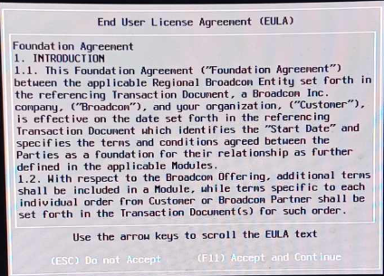

## 9. Select the ESXi Installation Destination

The installer must be installed onto a separate USB device (different from the one containing the installation media).

1. On the disk selection screen, identify the USB device containing the ESXi installer.

  
View screenshot

  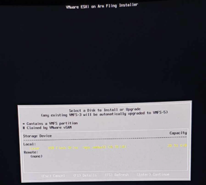

2. Do not select the installer USB.
3. Insert the separate USB storage device intended for the ESXi installation.

  
View screenshot

  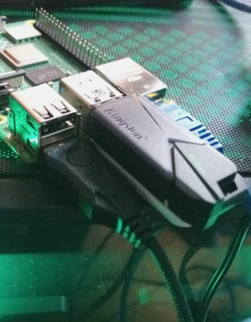

4. Press F5 to refresh the device list.
5. Wait for the additional USB to appear.
6. Carefully identify the new device.

  
View screenshot

  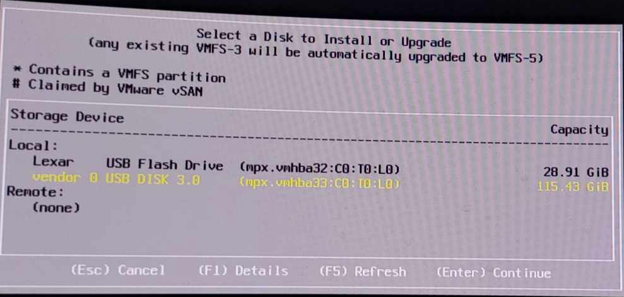

<strong>Warning</strong>: The selected installation destination will be overwritten. Ensure that the destination USB drive contains no data you need to preserve. 

Select the separate USB storage device and press Enter. 
Follow the subsequent confirmation prompts to proceed with the installation.

  
View screenshot

  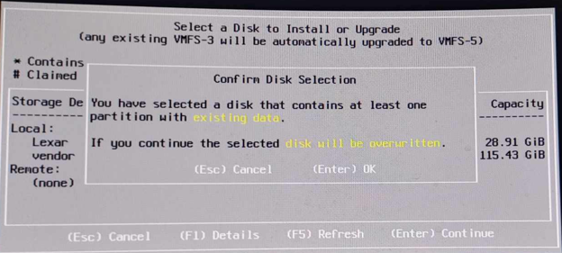

  
View screenshot

  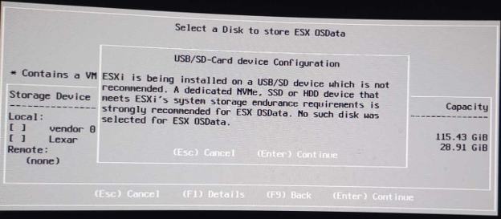

### Hardware Note

The original procedure intially described using a larger USB device for the ESXi installation. During the final setup, a 32 GB SanDisk USB Device was used instead. 

The original 128 GB USB Device was repurposed as a datastore later in the project. 

The installation procedure remained the same.

## 10. Configure the Keyboard and Root Password

Once the installation destination has been selected: 

1. Select the <strong>US Default</strong> keyboard layout.

  
View screenshot

  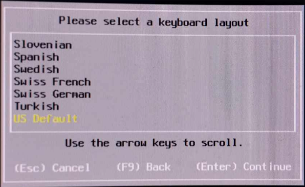

2. Press Enter
3. Configure a root password when prompted.
4. Confirm the password.

  
View screenshot

  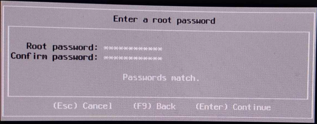

<strong>Important</strong>: Record the root password securely. It is required to access and administer the ESXi host. 

The original documentation notes that forgetting the root password may require erasing the ESXi installation USB and reinstalling the hypervisor. 

## 11. Confirm and Install ESXi

After configuring the keyboard and root password:

1. Press Enter to continue.
2. Review the installation confirmation.
3. Press F11 when prompted to begin installing the ESXi hypervisor.

  
View screenshot

  

4. Wait for the installation to complete.

  
View screenshot

  

Once installation finishes, remove the ESXi installer USB before rebooting.

Keep the microSD and the separate USB device containing the ESXi installation connected. In the example, remove the Lexar USB.  

Disconnect the internet Ethernet connection and connect the Raspberry Pi to the switch connected to the OpenWRT DHCP server.

The ESXi installation and boot files now reside on the USB storage device. 

## 12. Configure the UEFI Boot Order

The Raspberry Pi must boot from the USB device containing the installed ESXi hypervisor. 

1. Power on or reboot the Raspberry Pi.
2. Repeatedly press ESC to enter the UEFI interface.
3. Navigate to <strong>Boot Maintenance Manager</strong>.

  
View screenshot

  

4. Select <strong>Boot Options</strong>.

  
View screenshot

  

5. Select <strong>Change Boot Order</strong>.

  
View screenshot

  

6. Press Enter and highlight the USB device containing the ESXi installation.

  
View screenshot

  

8. Use the + key to move the USB device to the top of the boot order.

  
View screenshot

  

  
View screenshot

  

8. Press Enter to confirm.
9. Press F10 to save the configuration changes.
10. Press Y when prompted to confirm. 

## 13. Verify the Boot Order and Start ESXi

Return to the Boot Manager screen and verify that the ESXi installation USB is the first boot option.

  
View screenshot

  

Once confirmed:

1. Return to the language selection screen.
2. Select <strong>Continue</strong>.
3. Allow the Raspberry Pi to boot.

  
View screenshot

  

If the configuration is successful, the ESXi ARM interface should appear on the connected monitor.

  
View screenshot

  

The screen should display the ESXi host's IP address. 

  
View screenshot

  

This address is assigned through DHCP by the OpenWRT router configured in the earlier guide.

## 14. Access the ESXi Web Interface

Once the ESXi host has booted:

1. Connect a computer to the same network as the Raspberry Pi. (Ethernet cable to switch)
2. Open a web browser.
3. Navigate to the IP address displayed on the ESXi console.
4. Access the ESXi management interface.
5. Login using the root account and the password configured during installation.

The ESXi web interface provides access to the host's virtualization management features. 

Record the IP address assigned to each Raspberry Pi. These addresses will be used in the subsequent network configuration and host management procedures.

## 15. Verification and Results

The installation procedure is considered successful when:

- The Raspberry Pi initializes using the prepared microSD card and UEFI firmware.
- The ESXi installer boots from the dedicated installer USB.
- ESXi installs onto the separate destination USB.
- The UEFI boot order prioritizes the ESXi installation device.
- The Raspberry Pi boots into ESXi without requiring the installer USB. ESXi console displays a network IP address.
- The ESXi web interface is accessible from another computer on the network.

In the original project, this process was used to configure multiple Raspberry Pi 4 devices as ESXi hosts.

## 16. Scope and Limitations

This guide covers the preparation and installation of ESXi ARM on Raspberry Pi 4 hardware. 

It does not cover:

- Configuring DNS hostnames for ESXi hosts.
- Creating or mounting VMFS datastores.
- Registering multiple hosts in vCenter.
- Uploading and provisioning guest Operating Systems.
- Creating and testing virtual machine snapshots.

These procedures are documented in subsequent guides. 

The project used ESXi ARM on Raspberry Pi 4 hardware. Compatibility with other Raspberry Pi models and newer firmware versions should not be assumed.

## 17. Related Guides

- Guide 1 - Raspberry Pi Boot Configuration
- Guide 2 - OpenWRT Installation on Raspberry Pi 4
- Guide 3 - USB Storage Preparation for ESXi
- Guide 5 - OpenWRT DNS Configuration 
