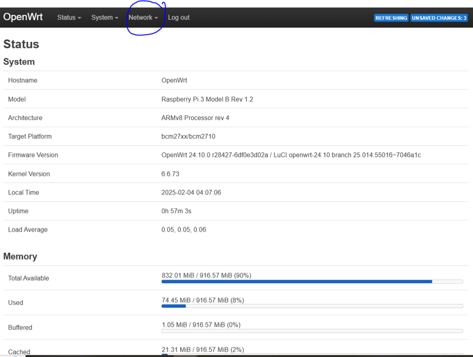
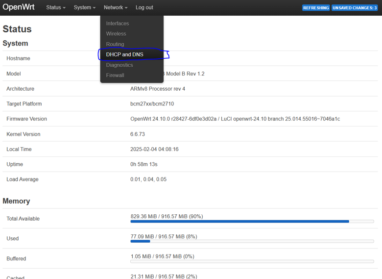
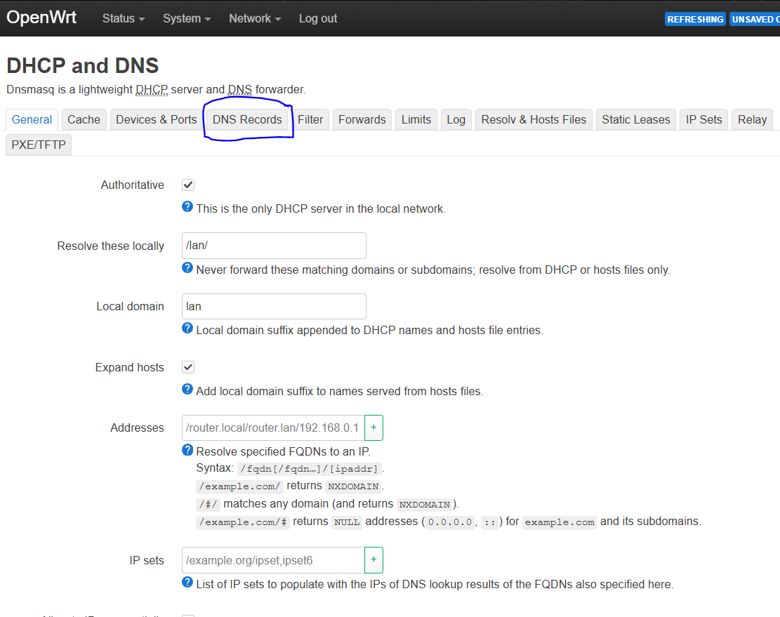
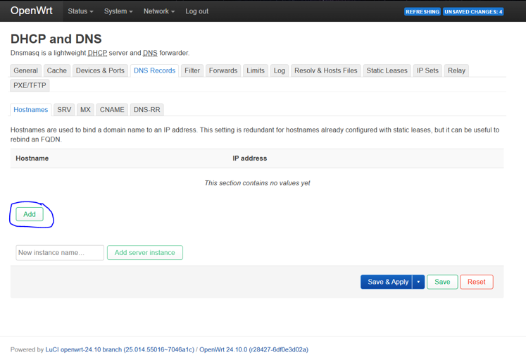

# OpenWRT DNS Configuration

## Overview

This guide explains how to configure local DNS records and static DHCP leases using OpenWRT.

In this project, OpenWRT acts as the DHCP and DNS server for the isolated Raspberry Pi virtualization network. Configuring local DNS records allows each ESXi host to be accessed using a memorable hostname instead of requiring its IP address to be entered manually. 

For example, instead of accessing an ESXi host using an address such as: 

https://192.168.1.105

You can access it using a hostname:

https://raspberrypi4_1.lan

The guide also explains how to configure static DHCP leases to ensure that each host consistently receives the same IP address. 

## Prerequisites

Before beginning, ensure that:

- OpenWRT is installed and running on the Raspberry Pi router.
- DHCP and DNS services are operational.
- The ESXi hosts are connected to the same network as the OpenWRT router.
- Each ESXi host has successfully booted.
- You can access the OpenWRT LuCI web interface.
- You know the IP address currently assigned to each ESXi host.

The OpenWRT management interface is accessible at: 

http://192.168.1.1

## 1. Log in to the OpenWRT Web Interface

1. Connect your computer to the network switch.
2. Ensure the OpenWRT router and ESXi hosts are connected to the same switch.
3. Open a web browser.
4. Navigate to http://192.168.1.1
5. Log in using the password configured during the OpenWRT installation.

Once logged in, you should see the LuCI administration interface.

<strong>Note</strong>: If you have forgotten your OpenWRT password, you will have to reinstall OpenWRT to your Raspberry Pi using Guide 2 instructions.

## 2. Identify the ESXi Host IP Addresses

Before creating DNS records, identify the IP address assigned to each ESXi host. 

When an ESXi host boots, its management console displays the IP address assigned through DHCP. 

Record the IP address for each Raspberry Pi. You will need these addresses when creating the DNS records. 

## 3. Navigate to DNS Records

Once logged in to OpenWRT: 

1. Open the <strong>Network</strong> menu.

  
View screenshot

  

2. Select <strong>DHCP and DNS</strong>.

  
View screenshot

  

3. Locate the <strong>DNS Records</strong>.

  
View screenshot

  

4. Select <strong>Add</strong> to create a new DNS record.

  
View screenshot

  

