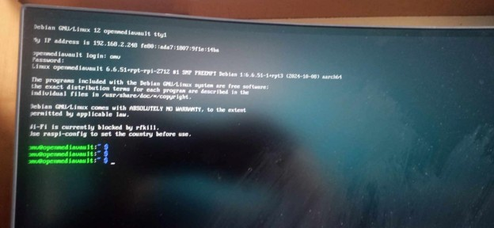
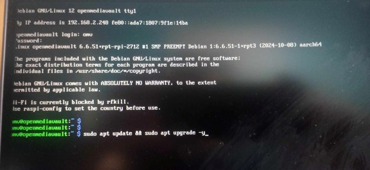
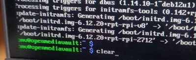
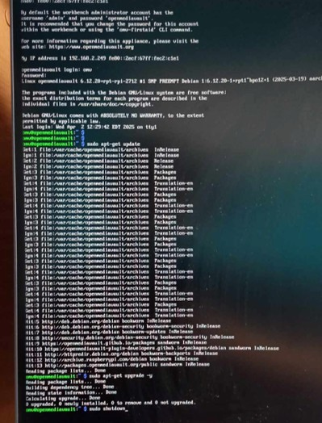
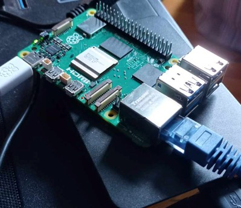
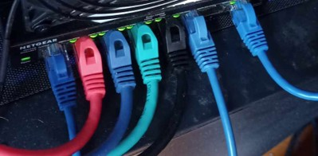
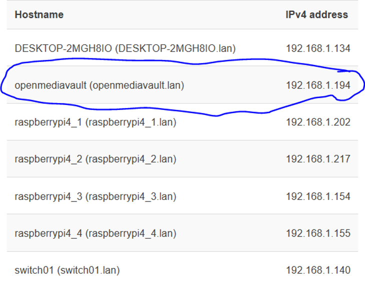
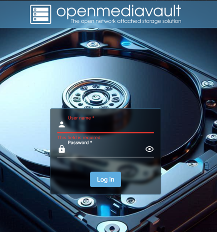
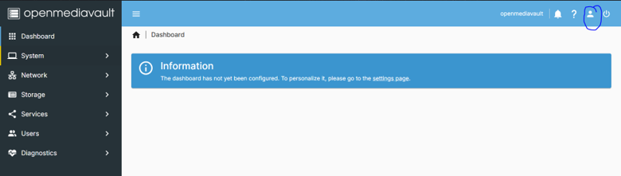

# Guide 7 - OpenMediaVault NAS Installation and NFS Datastore Configuration

## 1. Overview

This guide documents the installation and configuration of OpenMediaVault (OMV) on a Raspberry Pi 5, with an external 1 TB SSD drive configured as network-attached storage.

The NAS provides shared storage for the four Raspberry Pi ESXi hosts in the lab. An NFS share is created in OpenMediaVault and mounted as a datastore on each ESXi host.

The setup consists of:

- Raspberry Pi 5 (8 GB RAM) running Raspberry Pi OS Lite 64-Lite.
- 1 TB external storage drive (SSD)
- USB cable to connect SSD to Raspberry Pi Model 5's USB 3.0 port (blue port)
- OpenMediaVault for NAS Management
- NFS for sharing storage with the ESXi hosts.
- OpenWRT for DHCP and local network management.

<strong>Storage architecture</strong>:

- The physical 1 TB drive is formatted and mounted in OpenMediaVault.
- A shared folder is created on that filesystem.
- The folder is exported through NFS.
- Each ESXi host mounts the NFS export as a datastore.

## 2. Prerequisites

Before starting, ensure that you have:

- Raspberry Pi 5 with 8 GB RAM.
- microSD card for the Raspberry Pi OS.
- 1 TB external storage drive.
- USB 3.0 connection for the external drive.
- Ethernet connection to the lab network.
- Another computer to prepare the microSD card and access the management interfaces.

The Raspberry Pi should be connected to the network through Ethernet. Wi-Fi is not used in this setup.

## 3. Install Raspberry Pi OS Lite (64-bit)

This step has been prepared before. Please refer to Guide 4 Step 2 for more details with screenshots on how to install Raspberry Pi Lite OS. The steps will be re-written here:

1. Download and install Raspberry Pi Imager.
2. Insert the microSD card into your computer.
3. Open Raspberry Pi Imager.
4. Select the Raspberry Pi 5 as the device.
5. Select <strong>Raspberry Pi OS Lite (64-bit)</strong> as the operating system.
6. Select the microSD card as the storage device.
7. Configure the required operating system settings. (disable wifi)
8. Write the OS to the microSD card.

The Lite version provides a minimal OS installation without a desktop environment. 

Connect the Raspberry Pi to the internet via Ethernet (ensure wifi is disabled).

## 4. Update Raspberry Pi OS

Boot the Raspberry Pi and log in through the terminal. I connected via monitor and keyboard and the login details were configured directly in the OS settings. 

  
View screenshot

  

Update the package lists and install available updates using this command:

<code>sudo apt update && sudo apt upgrade -y</code>

  
View screenshot

  

Once the update process completes, continue with the OpenMediaVault installation.

## 5. Install OpenMediaVault

Clear the terminal with the following command:

<code>clear</code>

  
View screenshot

  

Use the following command to install OpenMediaVault:

<code>wget -O - https://github.com/OpenMediaVault-Plugin-Developers/installScript/raw/master/install | sudo bash</code>

Once the installation script has completed, reboot the Raspberry Pi:

<code>sudo reboot</code>

Allow the Raspberry Pi to restart before proceeding.

## 6. Verify Configuration

After the Raspberry Pi reboots, login, and verify that the update and upgrade commands have already installed by repeating the earlier command:

<code>sudo apt update && sudo apt upgrade -y</code>

  
View screenshot

  

Finally shutdown the Raspberry Pi with:

<code>sudo shutdown</code>

## 7. Connect Raspberry Pi to Lab Network

Once shutdown, disconnect the internet ethernet cable from your Raspberry Pi and connect your Pi to your switch with the OpenWRT DHCP server. Also, disconnect your monitor and keyboard from your Raspberry Pi 5 as they are no longer needed.

The Raspberry Pi 5 has a small white power button on its board. Press this to turn it on. 

  
View screenshot

  

  
View screenshot

  

The Ethernet cables in the image above are as follows from left to right:
1. Laptop
2. Raspberry Pi 4-1 (red cable)
3. Raspberry Pi 4-2 (blue cable)
4. Raspberry Pi 4-3 (green cable)
5. Raspberry Pi 4-4 (black cable)
6. Raspberry Pi 5-1 (blue cable) - OMV
7. Raspberry Pi 3-0 (blue cable) - OpenWRT DHCP server

## 8. Access the OpenMediaVault Web Interface

After installation, shutdown, connecting Raspberry Pi 5 to lab network and reboot, identify the Raspberry Pi's IP address

On your laptop, login to OpenWRT at <code>192.168.1.1</code> via a web browser. 
In my case, OpenWRT identified 192.168.1.194 as the Raspberry Pi 5 IP address. 

  
View screenshot

  

Set this IP address as a static IP address so the NAS retains a consistent IP address.

Open another tab, or browser and navigate to:

<code>http://192.168.1.194</code>

(the ip address OpenWRT assigned to your Raspberry Pi 5 device containing OMV)

Login using the default OpenMediaVault credentials

- <strong>Username</strong>: admin
- <strong>Password</strong>: openmediavault

  
View screenshot

  

Change this default password before relying on the NAS in an operational environment.

  
View screenshot

  

