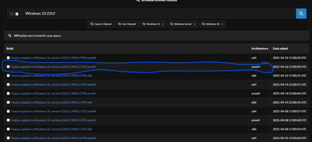
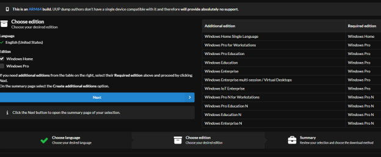
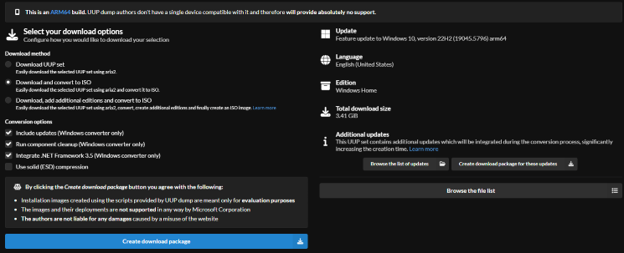

# Guide 8 - Downloading and Uploading ISO Images to VMware ESXi

## 1. Overview

This guide describes how to download operating-system images, prepare them for use with VMware ESXi, and upload them to an ESXi datastore.

VMware ESXi uses ISO images to install guest operating systems inside virtual machines. If an operating system download is provided in another format, it may need to be extracted or converted before it can be uploaded. 

For this project, clean operating-system installation images were stored on the OpenMediaVault NAS, using the my_nas datastore. This allowed the ESXi hosts to access the installation media from shared storage.

The guide covers:

- Downloading Windows ARM64 images.
- Obtaining older Windows versions through UUP Dump.
- Extracting downloaded archives.
- Preparing USB storage for large ISO files when necessary.
- Uploading ISO images to an ESXi datastore.

## 2. Download an Operating-System Image

The download process depends on the operating system you intend to install. 

ESXi uses ISO images for OS installation. If the downloaded file is not already an ISO, it must be extracted or converted into an ISO before uploading.

### 2.1 Windows 11 ARM64

For newer Windows operating systems, such as Windows 11, an ARM64 ISO can be downloaded directly from Microsoft's website: 

<a href="https://www.microsoft.com/en-us/software-download/windows11arm64">Download Windows 11 ARM64</a>

Make sure to select the ARM64 version, as the Raspberry Pi ESXi environment uses ARM architecture (ARM64 refers to the processor found on the Raspberry Pi Model 4). 

### 2.2 Older Windows Versions Using UUP Dump

For older Windows versions, such as Windows 10 or Windows XP, UUP Dump can be used to generate an installation ISO.

Website: 

<a href="https://uupdump.net/known.php?q=Windows+10+ARM64&p=7">UUP Dump - Windows 10 ARM64</a>

In this project, the Windows 10 ARM64 build 19045.5679 was downloaded, and instructions to follow will be for Windows 10. 

1. Visit UUP Dump using link above.
2. Search for <strong>Windows 10 Version 22H2</strong>.
3. Select the ARM64 architecture.
4. Click <strong>Next</strong> to continue.

  
View screenshot

  

### 2.3 Select the Windows Edition

On the edition selection screen, deselect Windows Pro. 

For this project, only Windows Home was required. Windows Pro includes additional features that were unnecessary for the intended VM and would consume additional resources.

  
View screenshot

  

### 2.4 Configure Download Options

On the download options screen:

- Select <strong>Create Download Package</strong>.
- Configure the optional .NET Framework inclusion if required by your intended use.
- Consider enabling <strong>Component Cleanup</strong>, which removes older, unnecessary Windows Setup files.

Component Cleanup is optional but can help produce a cleaner installation image.

Selecting <strong>Create Download Package</strong> generates a ZIP archive containing the files needed to create the Windows ISO. 

 

   
View summary

   
 

## 3. Prepare Images That Are Not Already ISOs

If your downloaded image is not in ISO format, it must be extracted or converted before it can be uploaded to ESXi.

