# Guide 9 - Creating a Virtual Machine Using an ISO

# 1. Overview

This guide describes how to create and configure a virtual machine (VM) on VMware ESXi using an uploaded operating-system ISO image. 

For this project, Windows 10 ARM64 was used as the primary installation example. The VM was hosted on a Raspberry Pi 4 running VMware ESXi ARM.

The guide covers:

- Creating a new Virtual Machine
- Selecting the guest operating system.
- Choosing a datastore for VM storage.
- Allocating CPU and memory resources.
- Mounting an ISO image
- Configuring the virtual network adapter.
- Installing Windows 10.
- Adjusting VM resources after installation.

Although Windows is used for the walkthrough, the same general VM creation process can be used for Linux distributions such as Ubuntu, Fedora, CentOS, and Kali Linux. Their installation procedures are generally more straightforward and typically involve following the on-screen installation instructions.

## 2. Prerequisites

Before starting, ensure that you have:

- A running VMware ESXi host.
- Access to the ESXi Host Client.
- An uploaded operating-system ISO image.
- An available datastore for VM storage.
- Sufficient available CPU and memory resources.

For this walkthrough, the following configuration was used:

<table>
  <tr>
    <th>Component</th>
    <th>Configuration</th>
  </tr>
  <tr>
    <td>Host Hardware</td>
    <td>Raspberry Pi 4 (8 GB RAM)</td>
  </tr>
  <tr>
    <td>Hypervisor</td>
    <td>VMware ESXi ARM</td>
  </tr>
  <tr>
    <td>Guest operating system</td>
    <td>Windows 10 ARM64</td>
  </tr>
  <tr>
    <td>Initial CPU allocation</td>
    <td>1 vCPU</td>
  </tr>
  <tr>
    <td>Initial memory allocation</td>
    <td>5 GB RAM</td>
  </tr>
  <tr>
    <td>Final CPU allocation</td>
    <td>2 vCPUs</td>
  </tr>
  <tr>
    <td>VM storage</td>
    <td>OpenMediaVault NAS (my_nas)</td>
  </tr>
  <tr>
    <td>Virtual Disk Size</td>
    <td>64 GB</td>
  </tr>
</table>

<strong>Important</strong>: The Raspberry Pi has 8 GB of physical RAM. ESXi requires memory for its own operation, so allocating too much memory to the guest OS can cause resource contention and instability. The hypervisor will always prioritize itself when there is resource contention so the guest OS will simply crash!

## 3. Create a Virtual Machine

After uploading the ISO image to a datastore (see Guide 8), navigate to the ESXi Host Client.

1. Open <strong>Virtual Machines</strong>.
2. Select <strong>Create / Register VM</strong>.

  
View screenshot

  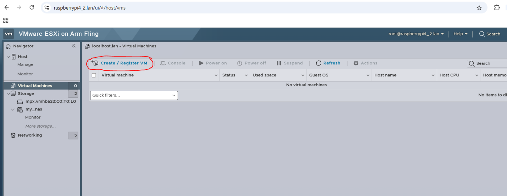

3. Choose <strong>Create a new virtual machine</strong>.

  
View screenshot

  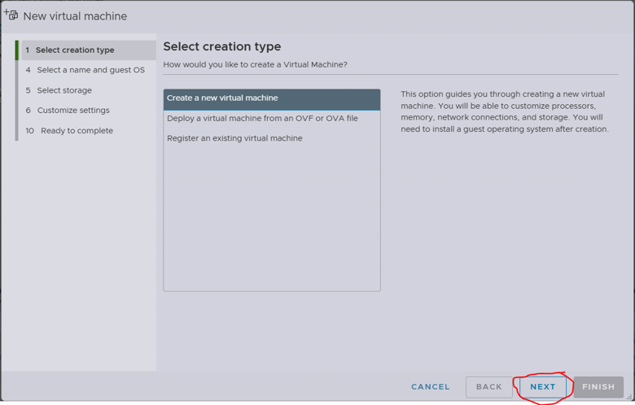

4. Continue to the configuration screen.

## 4. Select the VM Name and Operating System

Enter a descriptive name for the virtual machine.

Next, select the appropriate guest OS settings.

For the Windows 10 installation used in this project:

<table>
  <tr>
    <th>Setting</th>
    <th>Selection</th>
  </tr>
  <tr>
    <td>Compatibility</td>
    <td>ESXi 8.0 U2 virtual machine</td>
  </tr>
  <tr>
    <td>Guest OS Family</td>
    <td>Windows</td>
  </tr>
  <tr>
    <td>Guest OS Version</td>
    <td>Windows 10 (64-bit)</td>
  </tr>
</table>

If you are installing a Linux distribution or another supported operating system, select the corresponding guest OS family and version instead.

  
View screenshot

  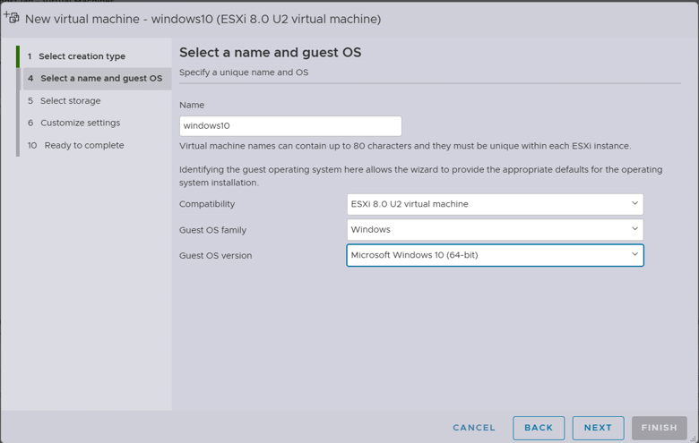

## 5. Select the Datastore

Choose where the virtual machine's files and virtual disk will be stored. 

In this project, two storage options are available (created earlier when we created our datastores):

- my_nas - The OpenMediaVault NAS datastore backed by the 1 TB SSD.
- usb_datastore - Local USB storage connected to the ESXi host.

For the final Windows installation select <strong>my_nas</strong>.

Although the USB datastore was tested initially, installing Windows onto USB storage took several hours and was unstable (and very slow). Installing onto the NAS SSD took less than an hour in the original testing.

The virtual machine's storage is isolated from the host's own operating-system storage. The guest OS accesses the virtual disk allocated to it rather than directly accessing the underlying datastore filesystem.

  
View screenshot

  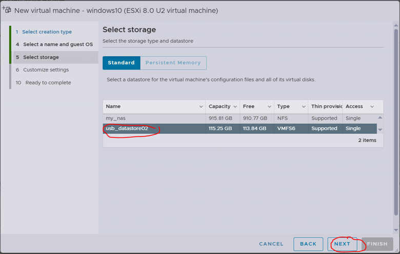

## 6. Customize Virtual Machine Settings

Configure the VM's hardware before proceeding with installation.

### 6.1 CPU Configuration

Set the initial CPU allocation to: - <Strong>1 vCPU</strong>

During testing, the Windows installation crashed when more than one CPU was allocated initially. For Linux distros, no crashes were observed when choosing 1-4.

Additional CPUs can be assigned after Windows has been successfully installed.

### 6.2 Memory Configuration

Set the memory allocation to :
- <Strong>5536 MB RAM </strong>

The Raspberry Pi used in this project has 8 GB of physical memory. ESXi itself requires memory to operate and allocating too much to the guest OS can cause resource contention.

During testing, allocating 6 GB of RAM caused the VM to crash; however using 5536 MB worked without fail. If you find that this number is also too much, reduce the allocation to 5.0 GB.

  
View screenshot

  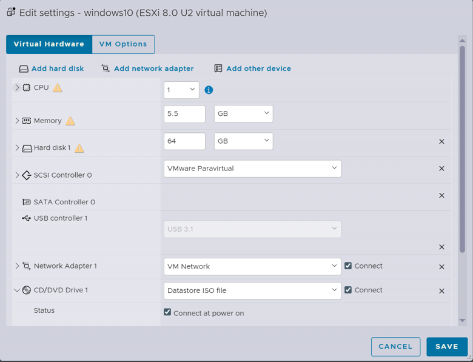

<strong>Note</strong>: In the final setup, the ISO was installed onto the SSD. (USB was also tested but the guest OS ran quite slowly.)

  
View screenshot

  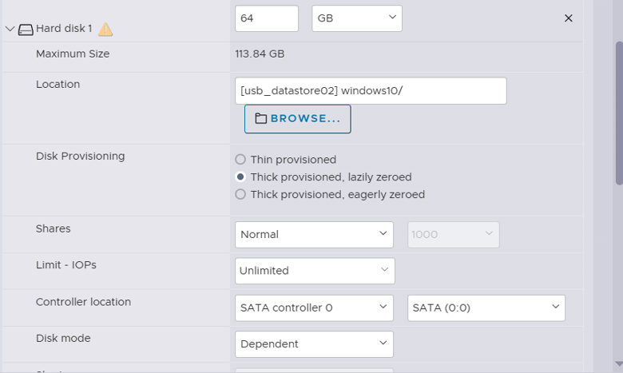

## 7. Select the ISO Image

Next, attach the operating-system ISO to the virtual machine.

1. Locate the CD/DVD drive configuration.
2. Select the option to use a datastore ISO file.

  
View screenshot

  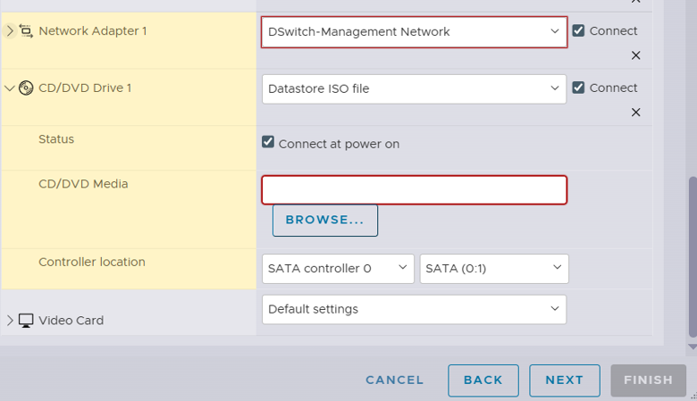

3. Click <strong>Browse</strong>.
4. Navigate to the <code>my_nas</strong> datastore.

  
View screenshot

  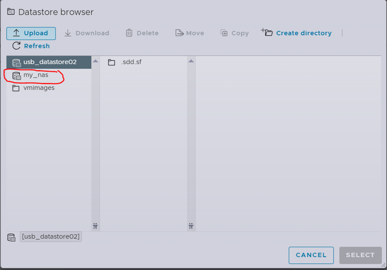

5. Select the uploaded Windows 10 ARM64 ISO.

  
View screenshot

  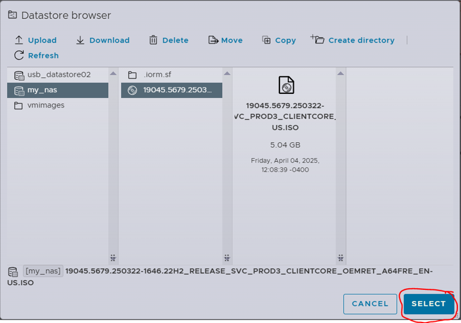

6. Confirm the selection.

If you have not uploaded an ISO image yet, you can do so at this stage through the datastore browser, as VMware allows this.

## 8. Configure the Network Adapter

Change the VM's network adapter to the configured virtual network.

  
View screenshot

  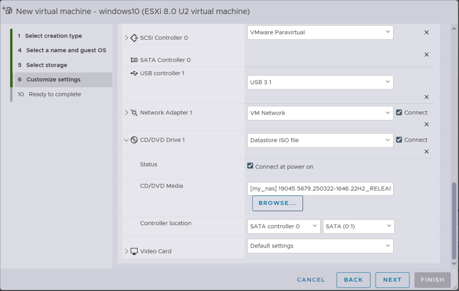

## 9. Review the VM Configuration

Before creating the VM, review the configuration.

For the final Windows installation, the important settings were:

<table>
  <tr>
    <th>Setting</th>
    <th>Final Initial Configuration</th>
  </tr>
  <tr>
    <td>Guest OS</td>
    <td>Windows 10</td>
  </tr>
  <tr>
    <td>CPU</td>
    <td>1 vCPU</td>
  </tr>
  <tr>
    <td>Memory</td>
    <td>5.0 GB</td>
  </tr>
  <tr>
    <td>Storage</td>
    <td><code>my_nas</code></td>
  </tr>
  <tr>
    <td>Network Adapter</td>
    <td>VM Network</td>
  </tr>
  <tr>
    <td>ISO</td>
    <td>Windows 10 ARM64</td>
  </tr>
</table>

Confirm that the NAS datastore is selected rather than the USB datastore.

Once everything is correct, finish creating the virtual machine.

  
View screenshot

  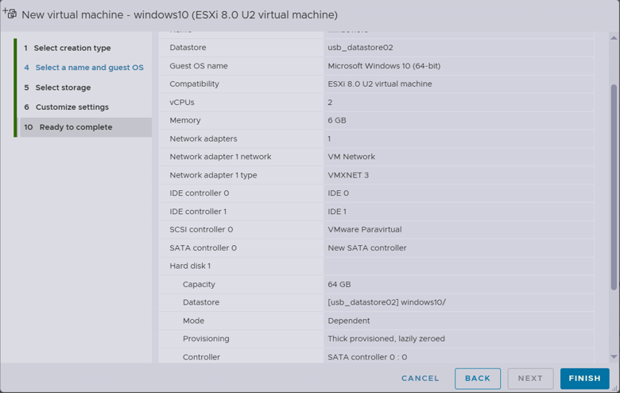

## 10. Start the Virtual Machine

Once the VM has been created:

1. Select the Virtual Machine.
2. Click <strong>Power On (Play)</strong>.

  
View screenshot

  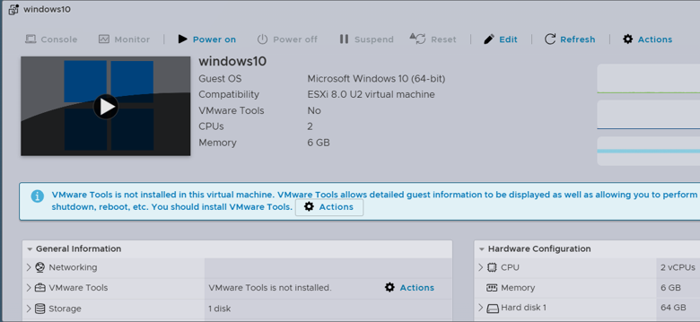

3. Open the VM console.
4. Click inside the console window.
5. Press any key when prompted to boot from the installation media.

<strong>Important</strong>: The installation media has a boot prompt timeout. You must click on the screen inside the window that pops up and press any key on your keyboard so the installer loads. If you do not press any key quickly enough, the VM may continue past the boot prompt without loading the installer. 

If this happens, select <strong>Reset</strong> on the VM and repeat the boot process.

  
View screenshot

  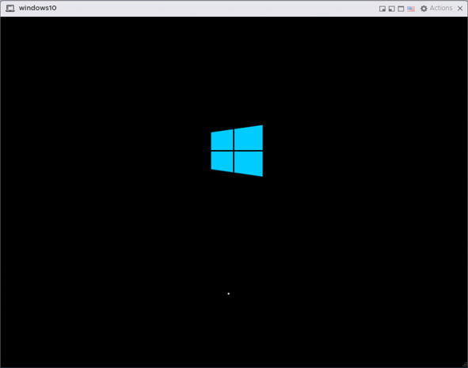

## 11. Install Windows 10

Once the Windows installer loads, follow the installation wizard. 

### 11.1 Begin Installation

Proceed through the initial Windows installation screens.

1. Select Language, Region and keyboard settings. This must match the original ISO. 

  
View screenshot

  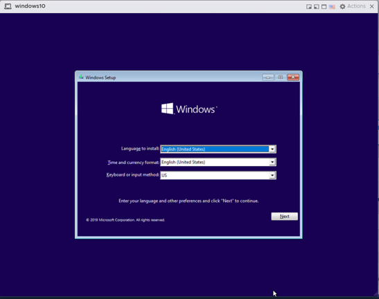

2. Click <strong>Install Now</strong>.

  
View screenshot

  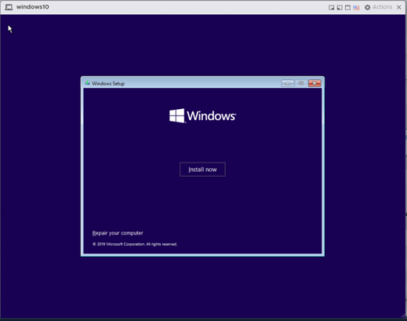

3. Select <strong>I don't have a product key</strong>.

  
View screenshot

  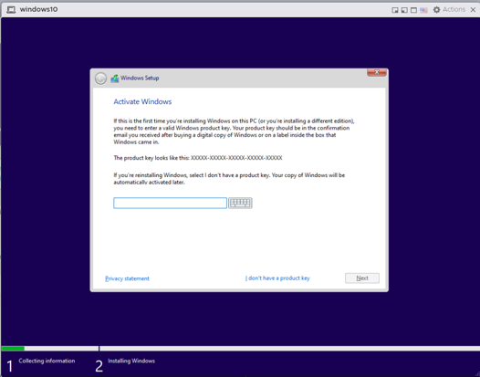

4. Accept the license terms and click <strong>Next</strong>.

  
View screenshot

  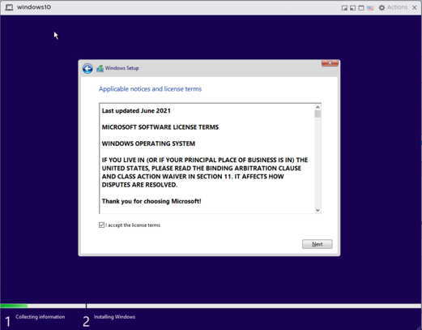

5. Select <strong>Custom Install</strong>.

  
View screenshot

  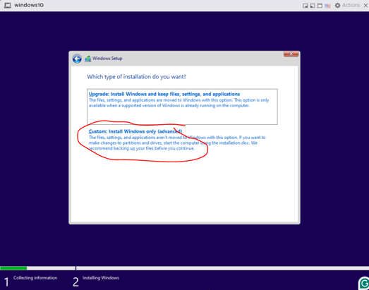

### 11.2 Select the Installation Disk

Select the virtual disk allocated to the VM.

In the original configuration, the virtual disk was approximately 64 GB. 

If multiple partitions appear, select each partition on the target virtual disk and delete it until only unallocated space remains.

Select the resulting unallocated space and click <strong>Next</strong>.

<strong>Warning</strong>: Only delete partitions belonging to the virtual disk created for this VM. Do not modify physical host or NAS storage. 

  
View screenshot

  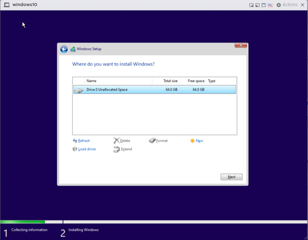

### 11.3 Allow Windows to Install

Windows will now begin installing.

Installation time depends on the storage device.

- USB datastore: several hours in the original testing, with stability issues.
- NAS SSD (<code>my_nas</code>): less than one hour in the original testing.

The final deployment used the NAS SSD instead of USB storage because of the stability and slow speed issues encountered during the USB installation experiment.

Allow the installation to complete and let the VM restart when prompted.

## 12. Complete Windows Initial Setup (OOBE)

After installation, Windows will launch its Out-of-Box-Experience (OOBE), which guides the user through initial OS configuration. 

### 12.1 Select the Region

In the original installation, selecting a different region resulted in an OOBELocal error. Selecting the United States avoided this issue. 

  
View screenshot

  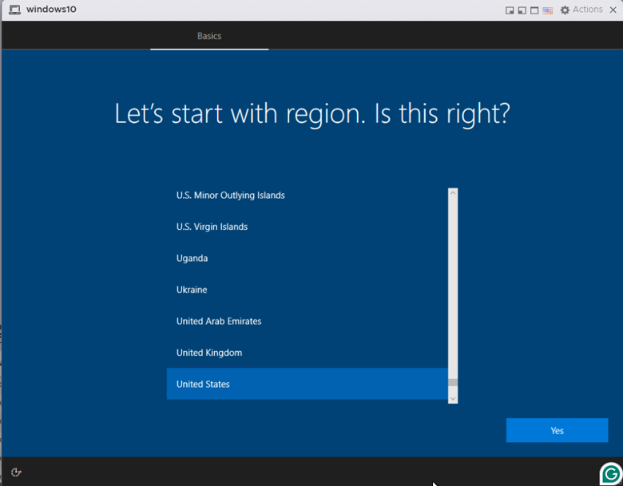

### 12.2 Bypass Network Configuration

When Windows reaches the network configuration screen, the installation can be completed without configuring internet connectivity. 

  
View screenshot

  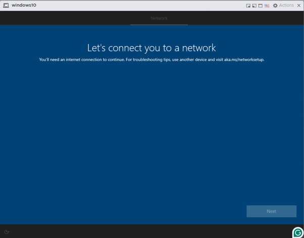

1. Press <strong>SHIFT + F10</strong> to open Command Prompt.

  
View screenshot

  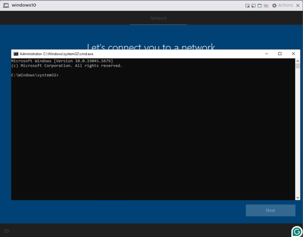

2. Enter the following command:
<code>OOBE\BYPASSNRO</code>

  
View screenshot

  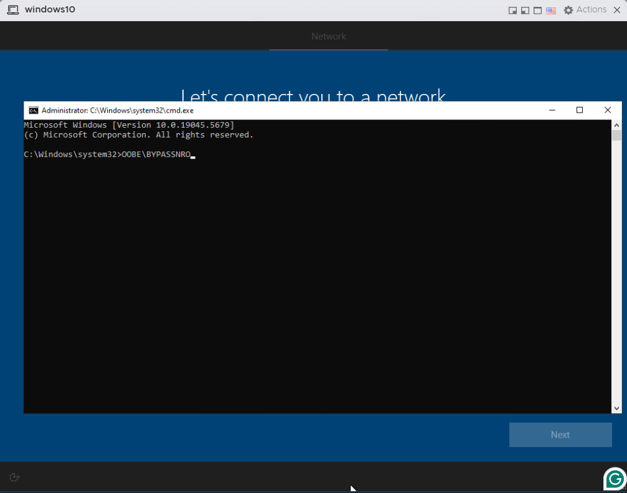

3. Press Enter

Windows will restart and return to the initial setup process. 

After restarting: 

1. Select <strong>I don't have internet</strong>.

  
View screenshot

  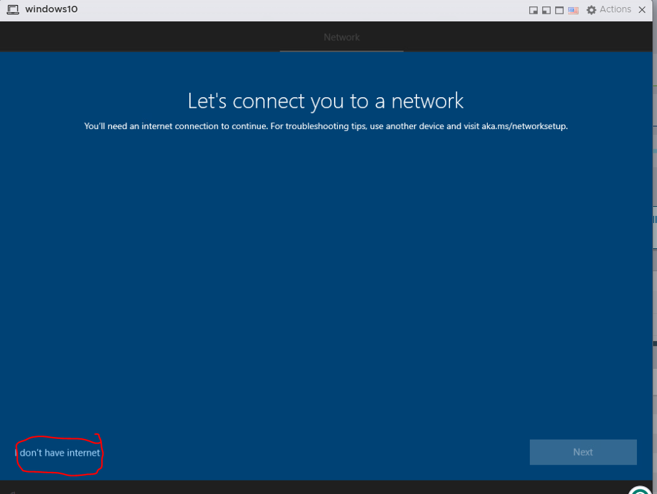

2. Select <strong>Continue with limited setup</strong>.

  
View screenshot

  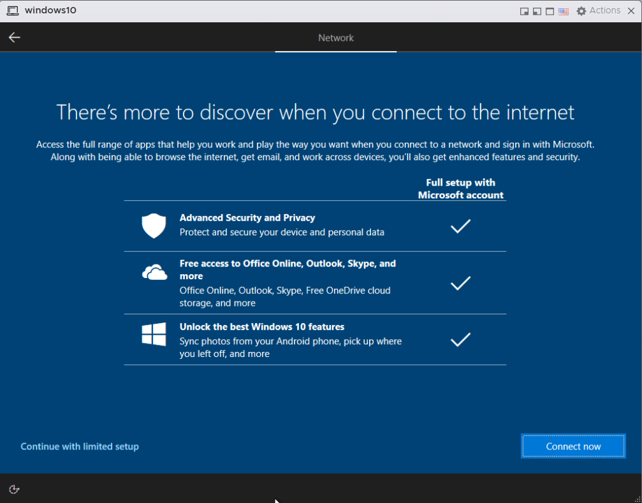

This allows Windows setup to proceed without an internet connection.

### 12.3 Create a User Account

Enter a username and create a password for the Windows VM.

Keep these credentials somewhere secure. Windows will also prompt you to configure security questions to help recover access if you forget the password.

  
View screenshot

  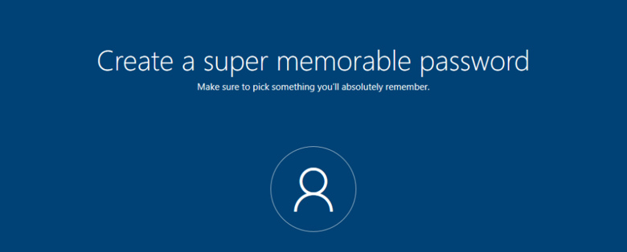

### 12.4 Configure Privacy Settings

Proceed through the remaining Windows setup screens.

- Disable Location services.
- Disable Find My Device.
- Select <strong>Accept</strong> to continue.

  
View screenshot

  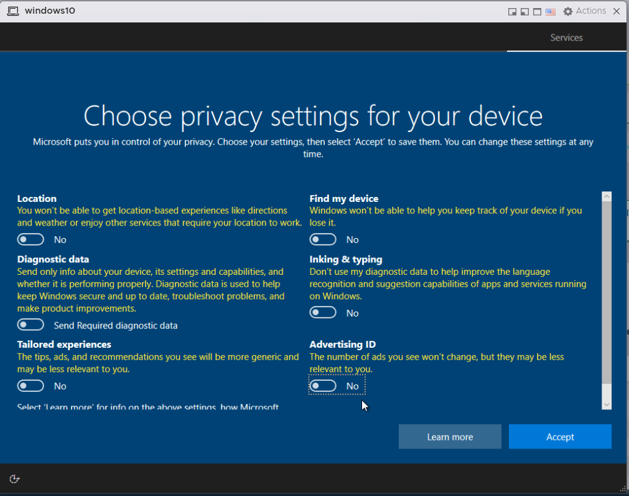

When prompted to enable Cortana, select <strong>Not Now</strong>.

  
View screenshot

  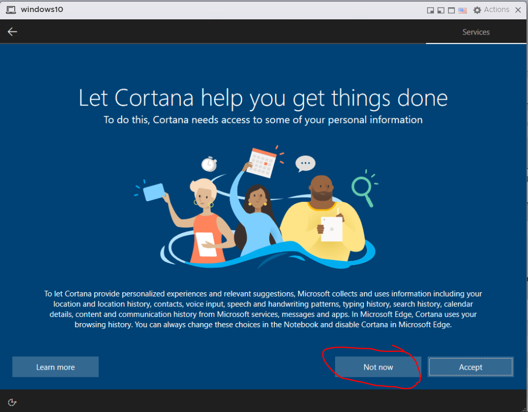

Because this VM is not being configured with internet connectivity, Cortana was unnecessary for the lab environment. 

  
View screenshot

  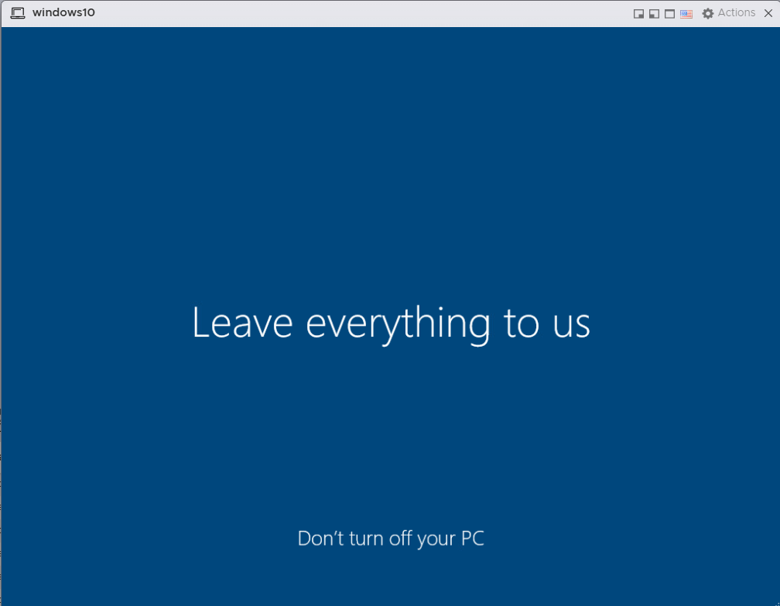

## 13. Verify the Windows Installation

Allow Windows to complete its initial configuration.

Once setup finishes, the Windows desktop should appear inside the ESXi console.

At this point, the Windows 10 virtual machine has been successfully installed and is running on VMware ESXi hosted by a Raspberry Pi 4.

  
View screenshot

  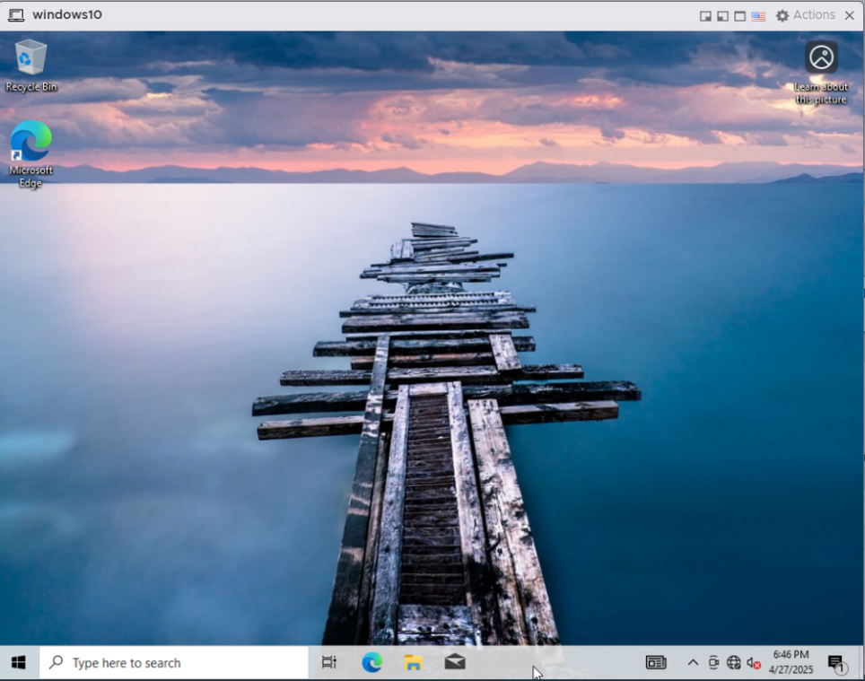

